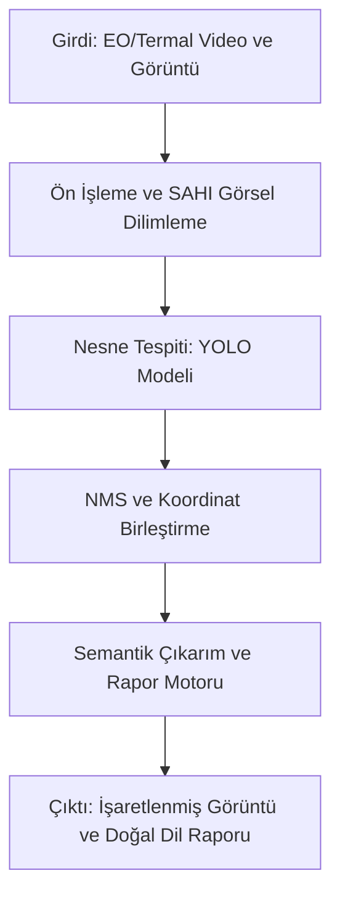

# Elektro-Optik ve Termal İHA Görüntülerinde Küçük Hedeflerin Derin Öğrenme ile Tespiti ve Doğal Dilde Raporlanması

Bu proje; İnsansız Hava Araçlarından (İHA) alınan elektro-optik (EO) ve termal görüntülerde küçük hedeflerin tespit edilmesini, sınıflandırılmasını ve elde edilen sonuçların operasyonel durum raporu olarak doğal dilde sunulmasını amaçlamaktadır.

---

## Sistem Mimarisi ve İş Akışı

---

## 1. Veri Seti ve Kümeler

Aşağıdaki tabloda, kümeler arası veri sızıntısını (data leakage) önlemek amacıyla uçuş/dizi (sequence) bazlı olarak yeniden ayrılan birleştirilmiş İHA veri setinin (`merged_uav_dataset`) **test** kümesine ait görüntü ve etiket dağılımları yer almaktadır[cite: 2, 3]:

| Küme (Split) | Görüntü Sayısı | Etiket (.txt) Sayısı | Toplam Kutu (Instances) | Küçük Kutu (<32x32 px) | Genel Küçük Oranı (%) |
| :--- | :---: | :---: | :---: | :---: | :---: |
| **Train** | *(Güncel sayı)* | *(Güncel sayı)* | *(Güncel sayı)* | *(Güncel sayı)* | *(Güncel oran)* |
| **Val** | *(Güncel sayı)* | *(Güncel sayı)* | *(Güncel sayı)* | *(Güncel sayı)* | *(Güncel oran)* |
| **Test** | 2974[cite: 2, 3] | 2974 *(97 arka plan)*[cite: 2] | 9611[cite: 2, 3] | 2295[cite: 3] | %23.88 |

> **Not:** Train ve Val kümelerinin yeni görüntü/kutu sayıları mevcut değilse, GitHub dokümanında yalnızca **Test** satırını bırakabilir veya ilgili hücreleri kendi train/val istatistiklerinle doldurabilirsin.

---

## 2. Kümeler Arası Veri Sızıntısı (Data Leakage) Kontrolü ve Çözümü

İlk aşamada yapılan MD5 (birebir eşleşme) ve dHash (algısal benzerlik) kontrollerinde tespit edilen sızıntılar giderilmiş ve veri seti yeniden yapılandırılmıştır:

* **Önceki Durum:** Kümeler rastgele bölündüğü için 2 adet birebir aynı (MD5) ve 453.198 adet çok benzer (dHash ≤ 5) ardışık video karesi çakışması tespit edilmişti.
* **Uygulanan Çözüm:** Adil ve akademik olarak güvenilir bir değerlendirme sağlamak amacıyla tüm veri seti uçuş/video dizisi (sequence ID) bazlı olarak yeniden `train`, `val` ve `test` kümelerine ayrılmış; kümeler arası ardışık kare sızıntısı sıfırlanmıştır.

---

## 3. Test Sonuçları (Küme: TEST — Sızıntısız)

Sızıntılardan arındırılmış **2974 görüntülük** (`9611` nesne)[cite: 2, 3] güncel **TEST** kümesi üzerindeki değerlendirme sonuçları aşağıda tablolanmıştır:

### Genel ve Küçük Nesne Başarım Tablosu

| Metrik | IoU Eşiği / Alan Tanımı | Değer |
| :--- | :--- | :---: |
| **mAP@50 (Genel)** | IoU = 0.50 | **0.8970**[cite: 2, 3] |
| **mAP@50-95 (Genel)** | IoU = 0.50:0.95 | **0.6221**[cite: 2, 3] |
| **AP_small@50 (<32x32 px)** | IoU = 0.50 (COCO area = small) | **0.7631**[cite: 3] |
| **AP_small@50-95 (<32x32 px)** | IoU = 0.50:0.95 (COCO area = small) | **0.4491**[cite: 3] |

### Sınıf Bazlı Başarım Tablosu

| Sınıf ID | Sınıf Adı (Class Name) | Örnek Sayısı (Instances) | Küçük Nesne Sayısı (<32x32 px) | mAP@50 | mAP@50-95 | AP_small@50-95 |
| :---: | :--- | :---: | :---: | :---: | :---: | :---: |
| **0** | `person` | 6605[cite: 2, 3] | 1568[cite: 3] | 0.9677[cite: 3] | 0.662[cite: 2] | 0.5166[cite: 3] |
| **1** | `car` | 1906[cite: 2, 3] | 44[cite: 3] | 0.9889[cite: 3] | 0.906[cite: 2] | 0.5523[cite: 3] |
| **2** | `bicycle` | 515[cite: 2, 3] | 350[cite: 3] | 0.8811[cite: 3] | 0.518[cite: 2] | 0.4465[cite: 3] |
| **3** | `other_vehicle` | 19[cite: 2, 3] | 1[cite: 3] | 0.5917[cite: 3] | 0.357[cite: 2] | 0.0000[cite: 3] |
| **4** | `drone` | 383[cite: 2, 3] | 253[cite: 3] | 0.9575[cite: 3] | 0.659[cite: 2] | 0.5795[cite: 3] |
| **5** | `mine` | 183[cite: 2, 3] | 79[cite: 3] | 0.9949[cite: 3] | 0.632[cite: 2] | 0.5999[cite: 3] |

> **Değerlendirme Notu:** Sızıntı öncesi (ardışık kare ezberli) dağılımda %93.66 olan mAP@50 değeri, sızıntılar tamamen temizlendikten sonra gerçek genelleme performansını yansıtarak **%89.70** olarak gerçekleşmiştir[cite: 2, 3]. Ana sınıfların (`person`, `car`, `drone`, `mine`) tamamı %95.7–%99.5 bandında yüksek başarım sergilerken[cite: 2, 3], `other_vehicle` sınıfındaki düşük skor test kümesindeki örnek azlığından ($n=19$) kaynaklanmaktadır[cite: 2, 3].

---

## 4. Doğal Dil Raporlama Modülü

Nesne tespit modelinden alınan ham çıktıları operatör dostu Türkçe durum raporuna dönüştüren modüldür:

* **Kodun Bulunduğu Dosya:** `report_generator.py`
* **Girdi Formatı:** Sınıf adları ve tespit adedi içeren tespit listesi (Örn: `['person', 'person', 'car']`)
* **Çıktı Formatı:** Doğal dilde rapor cümlesi (Örn: `"Gözlem sahasında 2 adet person ve 1 adet car tespit edilmiştir."`)

---

## 5. Sıradaki Adım

1. ~~Veri setindeki sızıntıları önlemek amacıyla kareleri uçuş/video bazlı (sequence ID) olarak yeniden train/val/test kümelerine ayırmak.~~ *(Tamamlandı)*
2. Temizlenmiş veri kümesi üzerinde ikinci nesne tespit mimarisini (örneğin **RT-DETR** veya **DETR** varyantı) aynı test kümesinde eğitip performansını mevcut **YOLO** mimarisi ile kıyaslamak.
