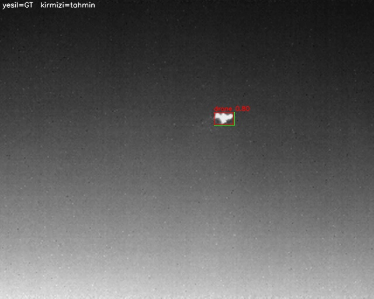
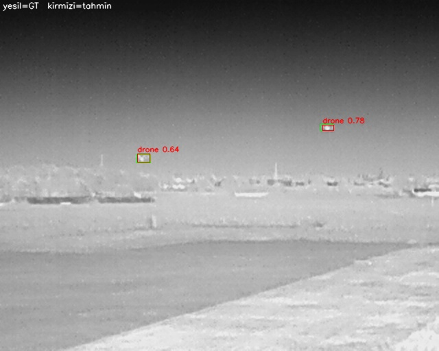
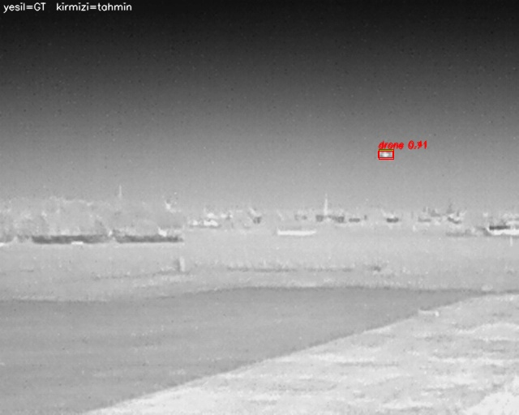
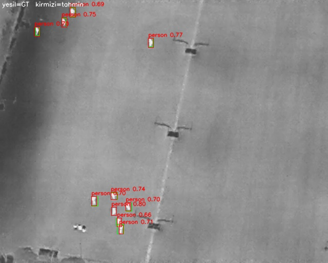
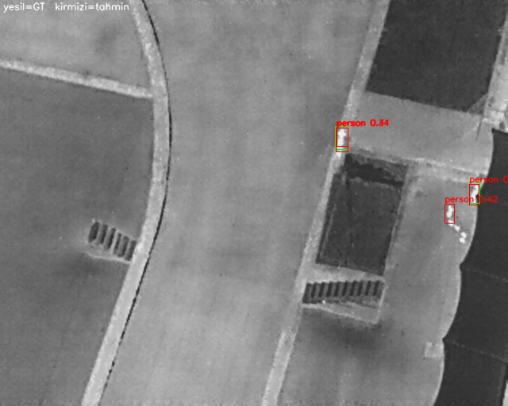

# Elektro-Optik ve Termal İHA Görüntülerinde Küçük Hedeflerin Derin Öğrenme ile Tespiti ve Doğal Dilde Raporlanması

Bu proje; İnsansız Hava Araçlarından (İHA) alınan elektro-optik (EO) ve termal görüntülerde küçük hedeflerin tespit edilmesini, sınıflandırılmasını ve elde edilen sonuçların operasyonel durum raporu olarak doğal dilde sunulmasını amaçlamaktadır.

---
## Sistem Mimarisi ve İş Akışı

<pre>
┌───────────────────────────────────────────────────────────────────────┐
│            Birleştirilmiş İHA Veri Seti (EO ve Termal)                │
└───────────────────────────────────┬───────────────────────────────────┘
                                    │
                                    ▼
┌───────────────────────────────────────────────────────────────────────┐
│  Veri Sızıntısı Kontrolü ve Sequence Bölme (MD5 / Hamming / NCC)      │
│  Bölme Parmak İzi: da43dd521edebb0d                                   │
└───────────────────┬───────────────────────────────────┬───────────────┘
                    │                                   │
                    ▼                                   ▼
      ┌───────────────────────────┐       ┌───────────────────────────┐
      │   Eğitim & Doğrulama      │       │   Bağımsız Test Kümesi    │
      │   (Train & Val)           │       │   (Test: 2974 Görüntü)    │
      └─────────────┬─────────────┘       └─────────────┬─────────────┘
                    │                                   │
          ┌─────────┴─────────┐                         │
          │                   │                         │
          ▼                   ▼                         │
  ┌───────────────┐   ┌───────────────┐                 │
  │ 1. Mimari:    │   │ 2. Mimari:    │                 │
  │ YOLOv8 (CNN)  │   │ RT-DETR (ViT) │                 │
  └───────┬───────┘   └───────┬───────┘                 │
          │                   │                         │
          └─────────┬─────────┘                         │
                    │                                   │
                    └─────────────────┬─────────────────┘
                                      │
                                      ▼
┌───────────────────────────────────────────────────────────────────────┐
│  Test Değerlendirmesi ve Kıyaslama (mAP@50, mAP@50-95, AP_small)      │
└───────────────────┬───────────────────────────────────┬───────────────┘
                    │                                   │
                    ▼                                   ▼
      ┌───────────────────────────┐       ┌───────────────────────────┐
      │ Performans Metrikleri     │       │ Tespit Edilen Sınıflar    │
      │ (metrics_test.csv)        │       │ ['person', 'car', ...]    │
      └───────────────────────────┘       └─────────────┬─────────────┘
                                                        │
                                                        ▼
                                          ┌───────────────────────────┐
                                          │ Doğal Dil Modülü          │
                                          │ (report_generator.py)     │
                                          └─────────────┬─────────────┘
                                                        │
                                                        ▼
                                          ┌───────────────────────────┐
                                          │ Türkçe Durum Raporu       │
                                          │ (20 Örnek Çıktı)          │
                                          └───────────────────────────┘
</pre>

### 1. Veri Seti ve Kümeler
Aşağıdaki tabloda, kümeler arası veri sızıntısını (data leakage) önlemek amacıyla uçuş/dizi (sequence) bazlı olarak yeniden ayrılan birleştirilmiş İHA veri setinin (`merged_uav_dataset`) test kümesine ait görüntü ve etiket dağılımları yer almaktadır:

| Küme (Split) | Görüntü Sayısı | Etiket (.txt) Sayısı | Toplam Kutu (Instances) | Küçük Kutu (<32x32 px) | Genel Küçük Oranı (%) |
| :--- | :---: | :---: | :---: | :---: | :---: |
| **Test** | 2974 | 2974 (97 arka plan) | 9611 | 2295 | %23.88 |

---

### 2. Kümeler Arası Veri Sızıntısı (Data Leakage) Kontrolü ve Çözümü
İlk aşamada yapılan MD5 (birebir eşleşme) ve dHash (algısal benzerlik) kontrollerinde tespit edilen sızıntılar giderilmiş, veri seti yeniden yapılandırılmış ve son doğrulama testleri tamamlanmıştır:

* **Önceki Durum:** Kümeler rastgele bölündüğü için 2 adet birebir aynı (MD5) ve 453.198 adet çok benzer (`dHash ≤ 5`) ardışık video karesi çakışması tespit edilmişti.
* **Uygulanan Çözüm:** Adil ve akademik olarak güvenilir bir değerlendirme sağlamak amacıyla tüm veri seti uçuş/video dizisi (`sequence ID`) bazlı olarak yeniden `train`, `val` ve `test` kümelerine ayrılmıştır.
* **Son Doğrulama Sonuçları (MD5 / Hamming / NCC):**
  * **Birden Fazla Kümeye Dağılmış Grup:** 0[cite: 3]
  * **Kümeler Arası Birebir Kopya (MD5):** 0[cite: 3]
  * **Kümeler Arası Yakın Kopya:** 0[cite: 3]
  * **Farklı Kümelerde Aynı Dosya Adı:** 0[cite: 3]
  * **Küme Çiftleri Arası Maksimum Benzerlik (NCC, Ham<=10):**
    * `val -> train`: 0.995[cite: 3]
    * `test -> train`: 1.000[cite: 3]
    * `test -> val`: 0.976[cite: 3]
  * **Doğrulama Çıktısı:** `SIZINTI YOK - train/val/test ayrık` (Bölme Parmak İzi / Split Fingerprint: `da43dd521edebb0d`)[cite: 3].

---

### 3. Test Sonuçları (Küme: TEST — Sızıntısız)
Sızıntılardan arındırılmış 2974 görüntülük (9611 nesne) güncel **TEST** kümesi üzerindeki değerlendirme sonuçları (`metrics_test.csv`) aşağıda tablolanmıştır:

#### Genel ve Küçük Nesne Başarım Tablosu
| Metrik | IoU Eşiği / Alan Tanımı | Değer |
| :--- | :--- | :---: |
| **mAP@50 (Genel)** | IoU = 0.50 | **0.8970** |
| **mAP@50-95 (Genel)** | IoU = 0.50:0.95 | **0.6221** |
| **AP_small@50 (<32x32 px)** | IoU = 0.50 (COCO `area <= 1024px`) | **0.7631** |
| **AP_small@50-95 (<32x32 px)** | IoU = 0.50:0.95 (COCO `area <= 1024px`) | **0.4491** |

#### Sınıf Bazlı Başarım Tablosu
| Sınıf ID | Sınıf Adı (Class Name) | Örnek Sayısı (Instances) | Küçük Nesne Sayısı (<32x32 px) | mAP@50 | mAP@50-95 | AP_small@50-95 |
| :---: | :--- | :---: | :---: | :---: | :---: | :---: |
| **0** | `person` | 6605 | 1568 | 0.9677 | 0.6617 | 0.5166 |
| **1** | `car` | 1906 | 44 | 0.9889 | 0.9062 | 0.5523 |
| **2** | `bicycle` | 515 | 350 | 0.8811 | 0.5175 | 0.4465 |
| **3** | `other_vehicle` | 19 | 1 | 0.5917 | 0.3568 | 0.0000 |
| **4** | `drone` | 383 | 253 | 0.9575 | 0.6589 | 0.5795 |
| **5** | `mine` | 183 | 79 | 0.9949 | 0.6316 | 0.5999 |

> **Değerlendirme Notu:** Sızıntı öncesi (ardışık kare ezberli) dağılımda %93.66 olan `mAP@50` değeri, sızıntılar tamamen temizlendikten sonra gerçek genelleme performansını yansıtarak **%89.70** olarak gerçekleşmiştir. Ana sınıfların (`person`, `car`, `drone`, `mine`) tamamı %95.7–%99.5 bandında yüksek başarım sergilerken, `other_vehicle` sınıfındaki düşük skor test kümesindeki örnek azlığından (`n=19`) kaynaklanmaktadır.

---

### 4. Doğal Dil Raporlama Modülü ve 20 Örnek Çıktı
Nesne tespit modelinden alınan ham çıktıları operatör dostu Türkçe durum raporuna dönüştüren modüldür:

* **Kodun Bulunduğu Dosya:** `report_generator.py`
* **Girdi Formatı:** Sınıf adları ve tespit adedi içeren tespit listesi (Örn: `['person', 'person', 'car']`)[cite: 1]
* **Çıktı Formatı:** Doğal dilde rapor cümlesi (Örn: `"Gözlem sahasında 2 adet person ve 1 adet car tespit edilmiştir."`)[cite: 1]

#### Test Kümesinden Seçilen 20 Örnek Tespit ve Durum Raporları
*(Görsellerde **yeşil** kutular gerçek etiketleri (GT), **kırmızı** kutular `conf >= 0.25` eşiğindeki model tahminlerini temsil etmektedir[cite: 4].)*

| Örnek | Tespit Görseli | Doğal Dil Durum Raporu |
| :---: | :---: | :--- |
| **01** |  | Gözlem sahasında 6 adet person tespit edilmiştir.[cite: 5] |
| **02** |  | Gözlem sahasında 4 adet car ve 1 adet person tespit edilmiştir.[cite: 5] |
| **03** |  | Gözlem sahasında 4 adet car ve 2 adet person tespit edilmiştir.[cite: 5] |
| **04** |  | Gözlem sahasında 3 adet car ve 2 adet person tespit edilmiştir.[cite: 5] |
| **05** |  | Gözlem sahasında 1 adet drone tespit edilmiştir.[cite: 5] |
| **06** |  | Gözlem sahasında 1 adet drone tespit edilmiştir.[cite: 5] |
| **07** |  | Gözlem sahasında 3 adet drone tespit edilmiştir.[cite: 5] |
| **08** |  | Gözlem sahasında 2 adet drone tespit edilmiştir.[cite: 5] |
| **09** |  | Gözlem sahasında 2 adet drone tespit edilmiştir.[cite: 5] |
| **10** |  | Gözlem sahasında 2 adet drone tespit edilmiştir.[cite: 5] |
| **11** |  | Gözlem sahasında 17 adet person tespit edilmiştir.[cite: 5] |
| **12** |  | Gözlem sahasında 10 adet person tespit edilmiştir.[cite: 5] |
| **13** |  | Gözlem sahasında 4 adet person tespit edilmiştir.[cite: 5] |
| **14** |  | Gözlem sahasında 3 adet person tespit edilmiştir.[cite: 5] |
| **15** |  | Gözlem sahasında 1 adet person tespit edilmiştir.[cite: 5] |
| **16** |  | Gözlem sahasında 1 adet person tespit edilmiştir.[cite: 5] |
| **17** |  | Gözlem sahasında 4 adet person tespit edilmiştir.[cite: 5] |
| **18** |  | Gözlem sahasında 2 adet person tespit edilmiştir.[cite: 5] |
| **19** |  | Gözlem sahasında 2 adet person tespit edilmiştir.[cite: 5] |
| **20** |  | Gözlem sahasında 5 adet person tespit edilmiştir.[cite: 5] |

---

