Elektro-Optik ve Termal İHA Görüntülerinde Küçük Hedeflerin Derin Öğrenme ile Tespiti ve Doğal Dilde Raporlanması
Bu proje; İnsansız Hava Araçlarından (İHA) alınan elektro-optik (EO) ve termal görüntülerde küçük hedeflerin tespit edilmesini, sınıflandırılmasını ve elde edilen sonuçların operasyonel durum raporu olarak doğal dilde sunulmasını amaçlamaktadır. Çalışmada CNN tabanlı YOLOv8n ile Transformer tabanlı RT-DETR-L mimarileri, sızıntısız (leakage-free) bağımsız bir test kümesinde karşılaştırılmıştır.
---
Sistem Mimarisi ve İş Akışı
<pre>
┌───────────────────────────────────────────────────────────────────────┐
│        Birleştirilmiş İHA Veri Seti (27.925 -> 26.086 Görüntü)        │
└───────────────────────────────────┬───────────────────────────────────┘
                                    │
                                    ▼
┌───────────────────────────────────────────────────────────────────────┐
│  Veri Sızıntısı Kontrolü ve Grup Bölme (MD5 / D4 dHash / NCC)         │
│  Bölme Parmak İzi: da43dd521edebb0d                                   │
└───────────────────┬───────────────────────────────────┬───────────────┘
                    │                                   │
                    ▼                                   ▼
      ┌───────────────────────────┐       ┌───────────────────────────┐
      │   Eğitim & Doğrulama      │       │   Bağımsız Test Kümesi    │
      │ (Train: 20.092 | Val: 3.020)│     │   (Test: 2974 Görüntü)    │
      └─────────────┬─────────────┘       └─────────────┬─────────────┘
                    │                                   │
          ┌─────────┴─────────┐                         │
          │                   │                         │
          ▼                   ▼                         │
  ┌───────────────┐   ┌───────────────┐                 │
  │ 1. Mimari:    │   │ 2. Mimari:    │                 │
  │ YOLOv8n (CNN) │   │ RT-DETR-L     │                 │
  └───────┬───────┘   └───────┬───────┘                 │
          │                   │                         │
          └─────────┬─────────┘                         │
                    │                                   │
                    └─────────────────┬─────────────────┘
                                      │
                                      ▼
┌───────────────────────────────────────────────────────────────────────┐
│  Test Değerlendirmesi ve Kıyaslama (mAP@50, mAP@50-95, AP_small)      │
└───────────────────┬───────────────────────────────────┬───────────────┘
                    │                                   │
                    ▼                                   ▼
      ┌───────────────────────────┐       ┌───────────────────────────┐
      │ Performans Metrikleri     │       │ Tespit Edilen Sınıflar    │
      │ (metrics_test.csv)        │       │ ['person', 'car', ...]    │
      └───────────────────────────┘       └─────────────┬─────────────┘
                                                        │
                                                        ▼
                                          ┌───────────────────────────┐
                                          │ Doğal Dil Modülü          │
                                          │ (report_generator.py)     │
                                          └─────────────┬─────────────┘
                                                        │
                                                        ▼
                                          ┌───────────────────────────┐
                                          │ Türkçe Durum Raporu       │
                                          │ (20 Örnek Çıktı)          │
                                          └───────────────────────────┘
---
1. Veri Seti ve Kümeler
Başlangıçtaki birleştirilmiş açık kaynak veri setinde (`umuttuygurr/aerial-uav-thermal-inferred-unified-dataset`) yer alan 27.925 görüntü içerisinden, `gun` (ID: 6) sınıfına ait 1.839 görüntü çıkarılmıştır (`excluded_gun`). Bu görüntülerin tamamı `06_gundataset` kaynağındandır (orijinal bölmedeki dağılımları: `train` 1.471, `val` 181, `test` 187; kaynağın `gun` etiketi taşımayan kalan 61 görüntüsü veri setinde tutulmuştur). Çıkarma gerekçesi yazarın gözlemidir: `gun` sınıfı orijinal test bölmesinde yalnızca 187 görselle (%6.68) temsil edildiğinden sınıf bazlı AP'nin kararsız kaldığı ve genel `mAP@50` ortalamasını düşürdüğü görülmüştür; çıkarma öncesi ölçüm bu depoda yer almamaktadır. Kalan 26.086 aktif görüntü (`train`: 20.092, `val`: 3.020, `test`: 2.974) ve 86.770 etiket, 6 hedef sınıf üzerinden analiz edilmiştir.
`gun` Sınıfının Çıkarılma Gerekçesi (Ayrıntı)
Yukarıdaki gerekçeye ek olarak raporda iki gözlem daha yer almaktadır:
Tek kaynak ve alan uyumsuzluğu: `06_gundataset` görüntüleri İHA hava perspektifinden değil, silah odaklı farklı sahne ve çekim koşullarından oluşmaktadır; bu nedenle İHA tabanlı diğer hedef sınıfların operasyonel bağlamıyla örtüşmediği değerlendirilmiştir.
Ardışık kareler: `gun` görüntüleri videolardan alınmış ardışık karelerden oluşmaktadır; yakın-kopya gruplamasında `1.839` görüntü yalnızca `21` gruba düşmektedir (en büyük üç grup `481`, `480` ve `297` görüntü).
`gun` sınıfını içeren 7 sınıflı veri setiyle yapılan ilk YOLOv8n denemesinin ilk üç epoch'luk doğrulama değerleri aşağıdadır. Epoch başına yaklaşık `640 s` süren eğitimde ikinci epoch'tan sonra `mAP@50`'de iyileşme gözlenmemiş; örneklem azlığı ve ardışık kare yapısı da göz önünde bulundurularak ek eğitim ve hesaplama zamanı kaybı yaşanmaması adına deneme bu noktada durdurulmuş ve sınıf veri setinden çıkarılmıştır. Tam bir eğitim ve test ölçümü yapılmamıştır.
Epoch	Birikimli Süre (s)	Precision	Recall	mAP@50 (val)	mAP@50-95 (val)
1	646.8	0.6513	0.6178	0.6632	0.3654
2	1283.8	0.8983	0.6016	0.7045	0.4297
3	1918.4	0.9022	0.6257	0.7024	0.4530

Aşağıdaki tabloda, kümeler arası veri sızıntısını (data leakage) önlemek amacıyla yakın-kopya grupları bütünlüğü korunarak katmanlı (`stratified`) şekilde yeniden ayrılan birleştirilmiş İHA veri setinin (`merged_uav_dataset`) test kümesine ait görüntü ve etiket dağılımları yer almaktadır:
Küme (Split)	Görüntü Sayısı	Etiket (`.txt`) Sayısı	Toplam Kutu (Instances)	Küçük Kutu (`<32x32 px`)	Genel Küçük Oranı (%)
Test	2974	2974 (97 arka plan)	9611	2295	%23.88
Test kümesinin sınıf bazlı dağılımı aşağıdadır (küçük nesne: COCO tanımıyla alan ≤ 1024 px):
Sınıf ID	Sınıf Adı	Örnek Sayısı	Küçük Nesne Sayısı	Sınıf İçi Küçük Oranı (%)
0	`person`	6605	1568	%23.74
1	`car`	1906	44	%2.31
2	`bicycle`	515	350	%67.96
3	`other_vehicle`	19	1	%5.26
4	`drone`	383	253	%66.06
5	`mine`	183	79	%43.17
	Toplam	9611	2295	%23.88

Küme Bazında Dağılım (Train / Val / Test)
Gruplar bölünmeden, sınıf dağılımını koruyan katmanlı bölmede hedef oranlar `%80 / %10 / %10` iken, büyük grupların bütünlüğü korunduğu için gerçekleşen oranlar `%77.02 / %11.58 / %11.40` olmuştur. Kaynak karışımı kümeler arasında benzerdir: LLVIP kaynaklı görüntü oranı `train`'de `%57.7`, `val`'de `%65.0`, `test`'te `%65.2`'dir.
Küme	Görüntü Sayısı	Oran (%)	Toplam Nesne	Küçük Nesne (≤ 32×32 px)
Train	20.092	%77.02	68.099	14.470 (%21.25)
Val	3.020	%11.58	9.060	2.673 (%29.50)
Test	2.974	%11.40	9.611	2.295 (%23.88)
Toplam	26.086	%100.0	86.770	19.438 (%22.40)
> **Val ve test farkı:** `val` kümesinin küçük nesne oranı (`%29.50`) `test` kümesinden (`%23.88`) yüksektir. Bu fark, grupların bütün hâlinde atanmasının kümelerin bileşimini kısmen farklılaştırmasıyla ilişkilidir; farkın tek bir kaynağa veya irtifa grubuna bağlı olduğu gösterilmemiştir (HIT-UAV görüntü sayısı `val` ve `test`'te `283` ve `284`; 130 m dizilerinin payı `%12.4` ve `%9.9`).
---
2. Kümeler Arası Veri Sızıntısı (Data Leakage) Kontrolü ve Çözümü
İlk aşamada yapılan MD5 (birebir eşleşme) ve dHash (algısal benzerlik) kontrollerinde tespit edilen sızıntılar giderilmiş, veri seti yeniden yapılandırılmış ve son doğrulama testleri tamamlanmıştır:
Önceki Durum ve Çok Aşamalı Kopya Tespiti: Birebir kopyalar için MD5 özet kontrolü (`2` birebir kopya) ve D4 simetri dönüşümleri (döndürme ve yansıtma) dahil edilerek `dHash (Hamming <= 6)` + `64x64` Normalize Çapraz Korelasyon (`NCC >= 0.95`) ölçütleriyle toplam `764.805` yakın-kopya çifti tespit edilmiş ve Union-Find algoritmasıyla `13.234` bağımsız grupta toplanmıştır.
Uygulanan Çözüm: Adil ve akademik olarak güvenilir bir değerlendirme sağlamak amacıyla bu grupların bütünlüğü bozulmadan katmanlı (`stratified`) bölme uygulanarak tüm veri seti yeniden `train` (`20.092`), `val` (`3.020`) ve `test` (`2.974`) kümelerine ayrılmıştır.
Son Doğrulama Sonuçları (MD5 / Hamming / NCC):
Birden Fazla Kümeye Dağılmış Grup: `0`
Kümeler Arası Birebir Kopya (MD5): `0`
Kümeler Arası Yakın Kopya (`Hamming <= 6`, `NCC >= 0.95`): `0`
Farklı Kümelerde Aynı Dosya Adı: `0`
Küme Çiftleri Arası Maksimum Benzerlik (NCC, Ham<=10):
`val -> train`: `0.995`
`test -> train`: `1.000`
`test -> val`: `0.976`
Doğrulama Çıktısı: `SIZINTI YOK - train/val/test ayrık` (Bölme Parmak İzi / Split Fingerprint: `da43dd521edebb0d`)
> **Not:** Daha gevşek bir denetimde (`Hamming <= 10`, `NCC >= 0.90`) `test -> train` NCC değerinin `1.000` çıkması, farklı dizilerde görsel olarak benzer sahnelerin (ör. aynı kamera düzeneği veya sabit arka plan) bulunabildiğini göstermektedir. Bu durum aynı dosya veya aynı uçuş dizisinin kümeler arasında paylaşıldığı anlamına gelmez; belirlenen eşiklerde (`Hamming <= 6`, `NCC >= 0.95`) yukarıdaki MD5, yakın-kopya ve dosya adı kontrolleri `0` sonuç vermiştir.
---
3. Doğal Dil Raporlama Modülü
Nesne tespit modellerinden alınan ham çıktıları operatör dostu Türkçe durum raporuna dönüştüren modüldür:
Kodun Bulunduğu Dosya: `report_generator.py` (`generate_report` fonksiyonu)
Girdi Formatı: Güven eşiği (`SAMPLE_CONF = 0.25`) üzerindeki sınıf adları ve tespit adedini içeren tespit listesi (Örn: `['person', 'person', 'car']`)
Çıktı Formatı: Doğal dilde rapor cümlesi (Örn: `"Gözlem sahasında 2 adet person ve 1 adet car tespit edilmiştir."`; tespit yoksa `"Gözlem sahasında herhangi bir nesne tespit edilmemiştir."`)
Çalışma Adımları: (1) tespitler `SAMPLE_CONF = 0.25` güven eşiğiyle süzülür; (2) kalan tespitlerin sınıf adları `Counter` ile sayılır; (3) her sınıf için "N adet sınıf_adı" kalıbı üretilir; (4) birden fazla sınıf varsa kalıplar virgül ve "ve" bağlacıyla birleştirilir; (5) hiç tespit yoksa boş-sahne cümlesi üretilir. Sınıf adları modelin etiketleriyle aynı biçimde, İngilizce (`person`, `car`) bırakılmıştır.
Örnek Seçimi: 20 örnek görüntü test kümesinden `SEED = 42` ile deterministik olarak seçilmiştir (10 görüntü küçük nesne içeren havuzdan, 10 görüntü genel havuzdan).
Kısıt: Modül deterministik ve halüsinasyonsuz özetler üretse de yalnızca güven eşiği üzerindeki sınıf sayılarını aktarmakta, nesneler arasındaki konumsal veya mekânsal ilişkileri (ör. "sol üstte", "birbirine yakın") betimleyememektedir.
---
4. Test Sonuçları ve 20 Örnek Çıktı (Küme: TEST — Sızıntısız)
(Tüm örnek görsellerde yeşil kutular gerçek etiketleri (GT), kırmızı kutular `conf >= 0.25` eşiğindeki model tahminlerini temsil etmektedir.)
4.1. YOLOv8n Test Sonuçları
Genel ve Küçük Nesne Başarım Tablosu (YOLOv8n)
Metrik	IoU Eşiği / Alan Tanımı	Değer
mAP@50 (Genel)	IoU = 0.50	0.8970
mAP@50-95 (Genel)	IoU = 0.50:0.95	0.6221
AP_small@50 (`<32x32 px`)	IoU = 0.50 (COCO area <= 1024px)	0.7631
AP_small@50-95 (`<32x32 px`)	IoU = 0.50:0.95 (COCO area <= 1024px)	0.4491
Sınıf Bazlı Başarım Tablosu (YOLOv8n)
Sınıf ID	Sınıf Adı (Class Name)	Örnek Sayısı (Instances)	Küçük Nesne Sayısı (`<32x32 px`)	mAP@50	mAP@50-95	AP_small@50	AP_small@50-95
0	`person`	6605	1568	0.9677	0.6617	0.9283	0.5166
1	`car`	1906	44	0.9889	0.9062	0.8832	0.5523
2	`bicycle`	515	350	0.8811	0.5175	0.8265	0.4465
3	`other_vehicle`	19	1	0.5917	0.3568	0.0000	0.0000
4	`drone`	383	253	0.9575	0.6589	0.9407	0.5795
5	`mine`	183	79	0.9949	0.6316	1.0000	0.5999
> **YOLOv8n Değerlendirme Notu:** Sızıntısız test kümesinde YOLOv8n `mAP@50` değeri `%89.70` olarak gerçekleşmiştir. Ana sınıfların (`person`, `car`, `drone`, `mine`) tamamı `%95.7–%99.5` bandında yüksek başarım sergilerken, `other_vehicle` sınıfındaki düşük skor test kümesindeki örnek azlığından (`n=19`) kaynaklanmaktadır.
YOLOv8n — Test Kümesinden Seçilen 20 Örnek Tespit ve Durum Raporları
Örnek	Tespit Görseli (YOLOv8n)	Doğal Dil Durum Raporu
01	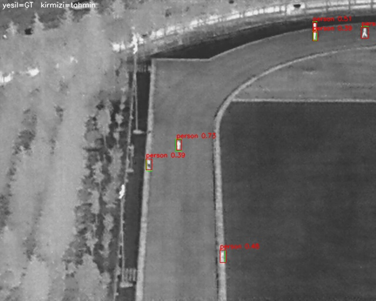	Gözlem sahasında 6 adet person tespit edilmiştir.
02		Gözlem sahasında 4 adet car ve 1 adet person tespit edilmiştir.
03	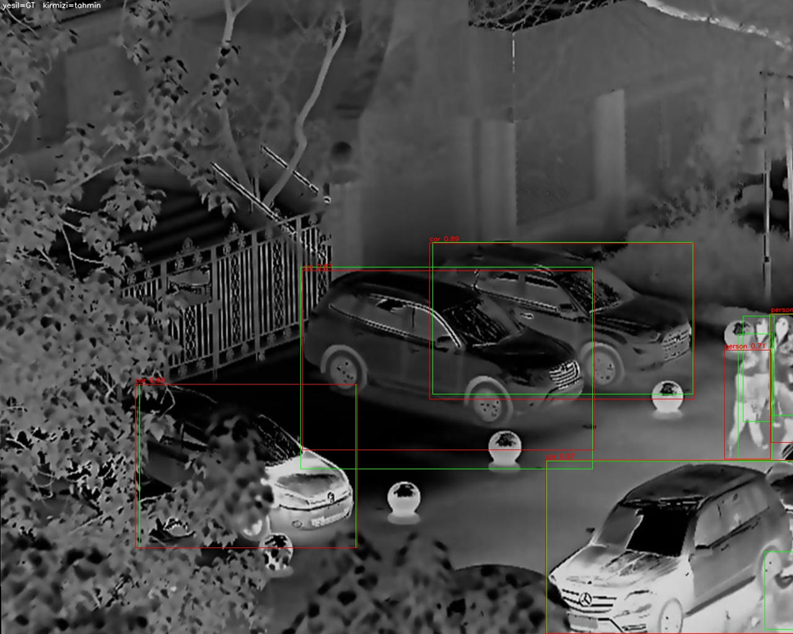	Gözlem sahasında 4 adet car ve 2 adet person tespit edilmiştir.
04	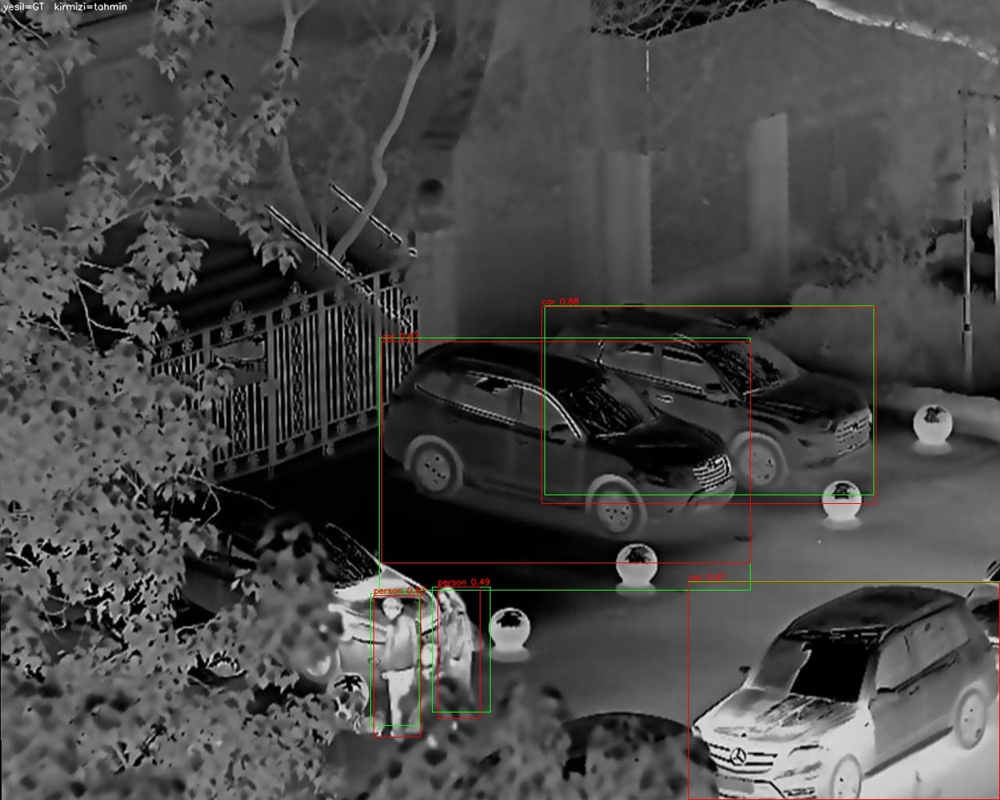	Gözlem sahasında 3 adet car ve 2 adet person tespit edilmiştir.
05		Gözlem sahasında 1 adet drone tespit edilmiştir.
06	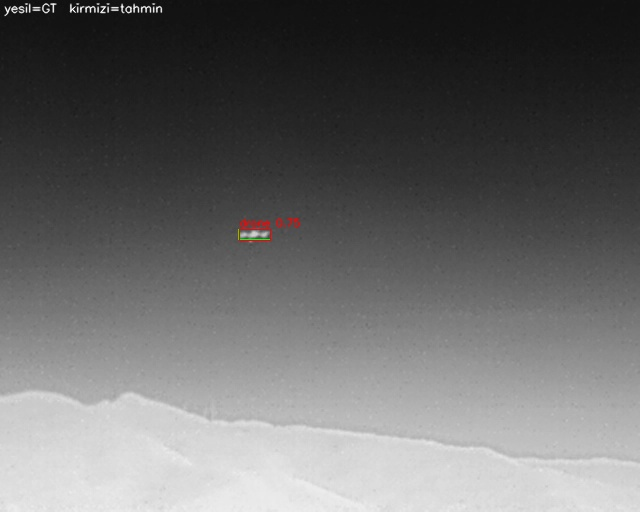	Gözlem sahasında 1 adet drone tespit edilmiştir.
07		Gözlem sahasında 3 adet drone tespit edilmiştir.
08	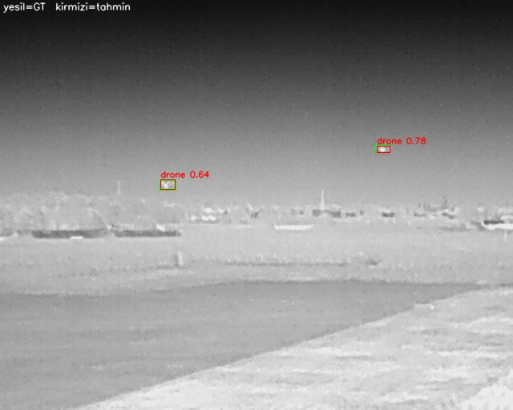	Gözlem sahasında 2 adet drone tespit edilmiştir.
09	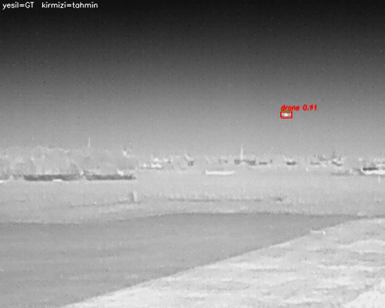	Gözlem sahasında 2 adet drone tespit edilmiştir.
10		Gözlem sahasında 2 adet drone tespit edilmiştir.
11	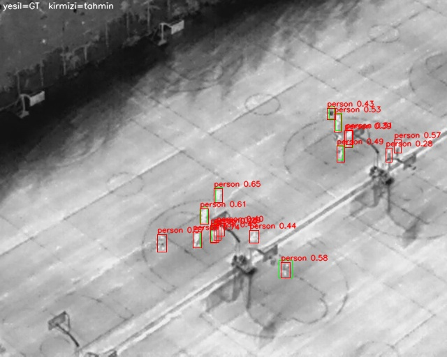	Gözlem sahasında 17 adet person tespit edilmiştir.
12	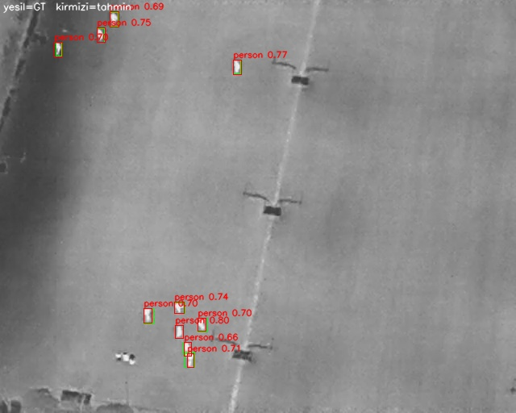	Gözlem sahasında 10 adet person tespit edilmiştir.
13		Gözlem sahasında 4 adet person tespit edilmiştir.
14	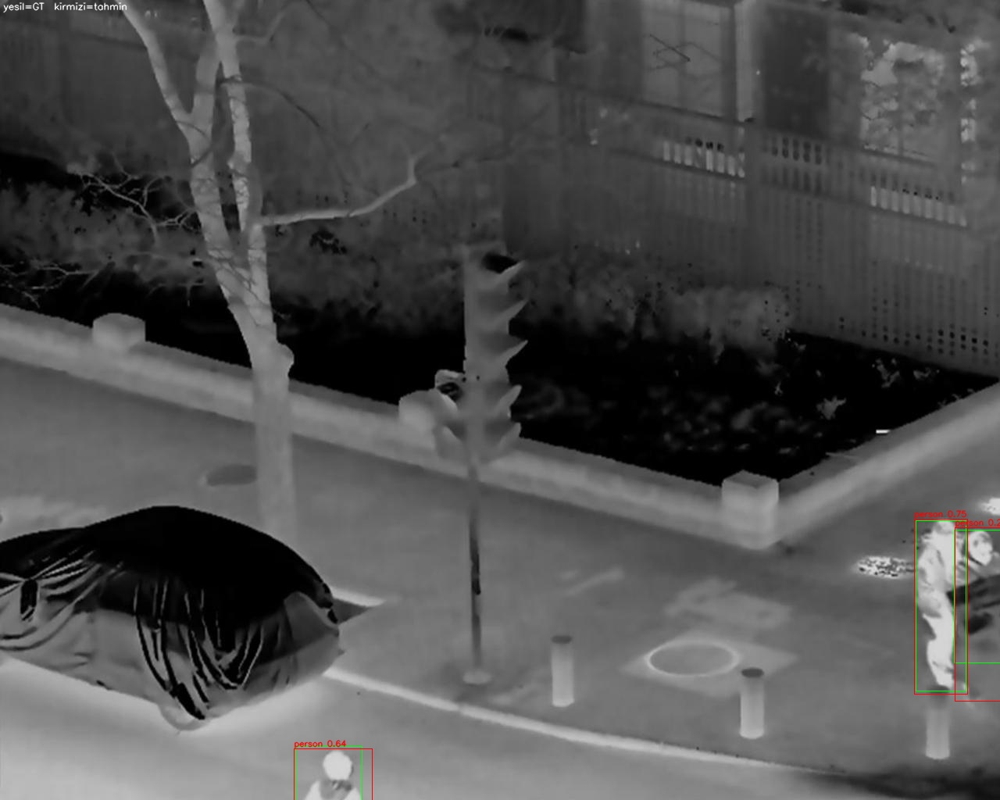	Gözlem sahasında 3 adet person tespit edilmiştir.
15		Gözlem sahasında 1 adet person tespit edilmiştir.
16		Gözlem sahasında 1 adet person tespit edilmiştir.
17	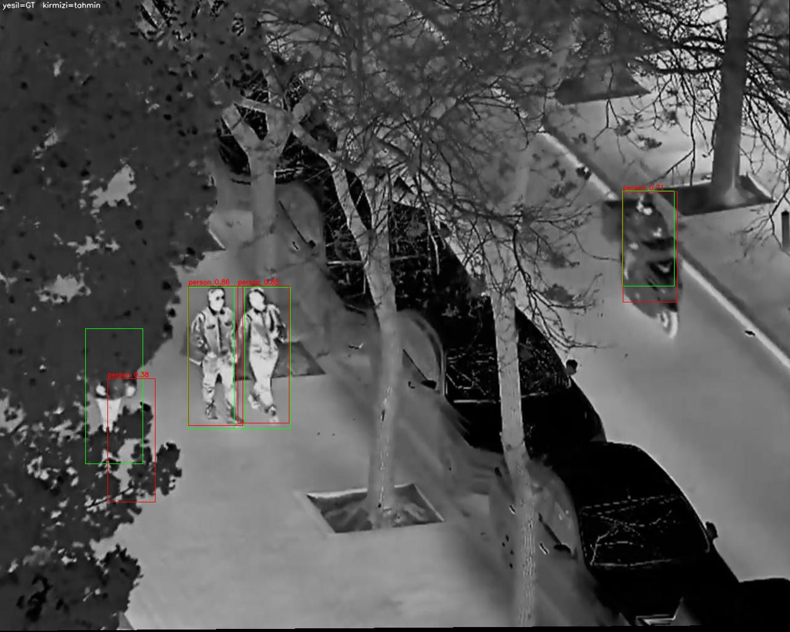	Gözlem sahasında 4 adet person tespit edilmiştir.
18	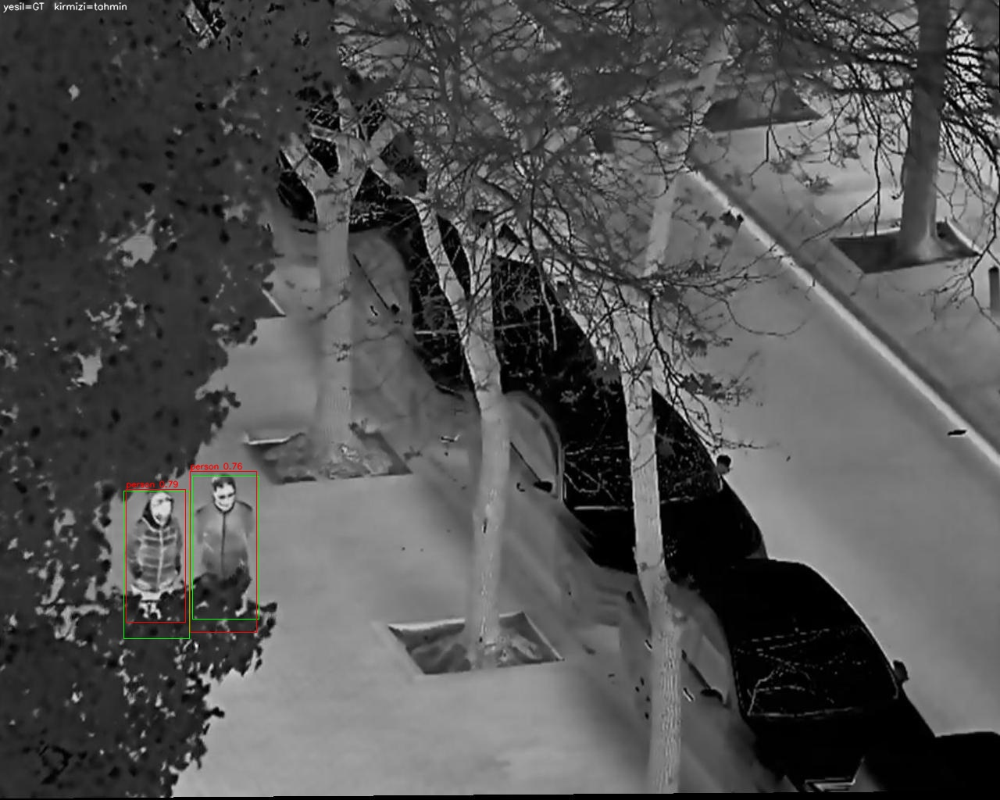	Gözlem sahasında 2 adet person tespit edilmiştir.
19	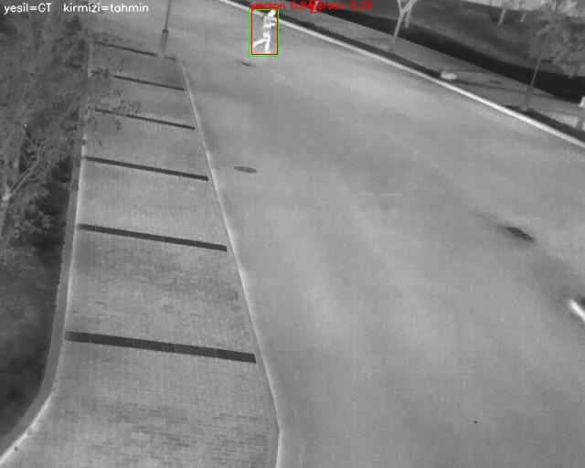	Gözlem sahasında 2 adet person tespit edilmiştir.
20	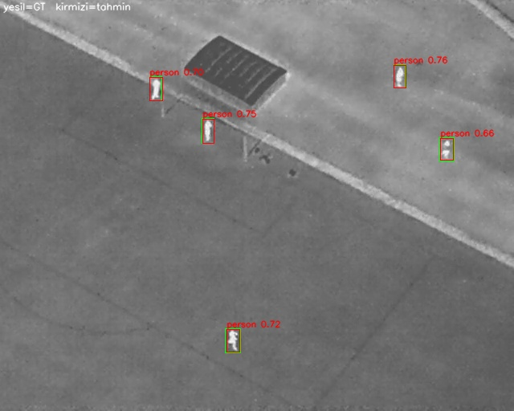	Gözlem sahasında 5 adet person tespit edilmiştir.
---
4.2. RT-DETR-L Test Sonuçları
Genel ve Küçük Nesne Başarım Tablosu (RT-DETR-L)
Metrik	IoU Eşiği / Alan Tanımı	Değer
mAP@50 (Genel)	IoU = 0.50	0.9119
mAP@50-95 (Genel)	IoU = 0.50:0.95	0.6684
AP_small@50 (`<32x32 px`)	IoU = 0.50 (COCO area <= 1024px)	0.7964
AP_small@50-95 (`<32x32 px`)	IoU = 0.50:0.95 (COCO area <= 1024px)	0.5306
Sınıf Bazlı Başarım Tablosu (RT-DETR-L)
Sınıf ID	Sınıf Adı (Class Name)	Örnek Sayısı (Instances)	Küçük Nesne Sayısı (`<32x32 px`)	mAP@50	mAP@50-95	AP_small@50	AP_small@50-95
0	`person`	6605	1568	0.9803	0.6863	0.9652	0.5531
1	`car`	1906	44	0.9885	0.8836	0.8474	0.5543
2	`bicycle`	515	350	0.9201	0.5892	0.9009	0.5471
3	`other_vehicle`	19	1	0.6273	0.4348	0.1111	0.0667
4	`drone`	383	253	0.9627	0.6883	0.9550	0.6164
5	`mine`	183	79	0.9921	0.7280	0.9986	0.8462
> **RT-DETR-L Değerlendirme Notu:** Transformer tabanlı öz-dikkat (self-attention) mimarisine sahip RT-DETR-L modeli, sızıntısız bağımsız test kümesinde `%91.19` genel `mAP@50` ve `%53.06` `AP_small@50-95` başarımına ulaşmıştır. Özellikle küçük hedeflerin yoğun olduğu `mine` (`AP_small@50-95 = 0.8462`), `drone` (`0.6164`) ve `bicycle` (`0.5471`) sınıflarında güçlü konumlandırma hassasiyeti sergilemiştir.
RT-DETR-L — Test Kümesinden Seçilen 20 Örnek Tespit ve Durum Raporları
Örnek	Tespit Görseli (RT-DETR-L)	Doğal Dil Durum Raporu
01		Gözlem sahasında 6 adet person tespit edilmiştir.
02	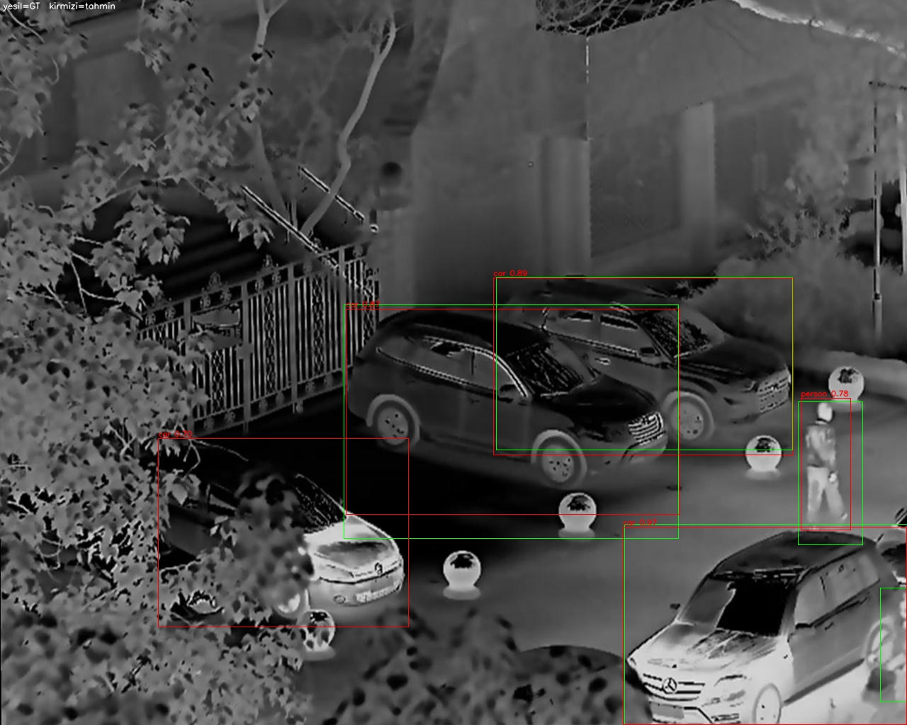	Gözlem sahasında 6 adet car ve 2 adet person tespit edilmiştir.
03		Gözlem sahasında 4 adet car ve 6 adet person tespit edilmiştir.
04		Gözlem sahasında 3 adet car ve 3 adet person tespit edilmiştir.
05	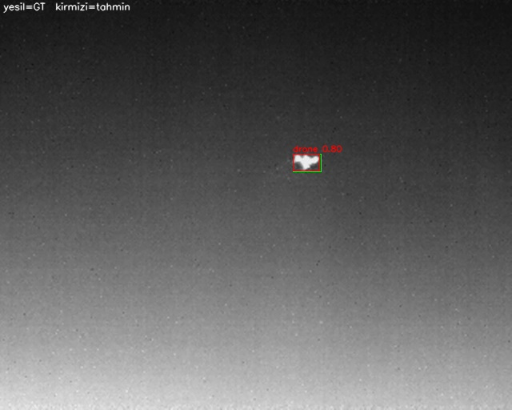	Gözlem sahasında 1 adet drone tespit edilmiştir.
06		Gözlem sahasında 1 adet drone tespit edilmiştir.
07	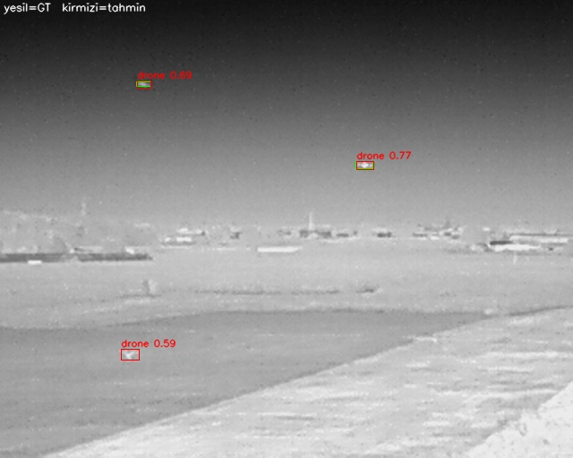	Gözlem sahasında 3 adet drone tespit edilmiştir.
08		Gözlem sahasında 2 adet drone tespit edilmiştir.
09		Gözlem sahasında 1 adet drone tespit edilmiştir.
10	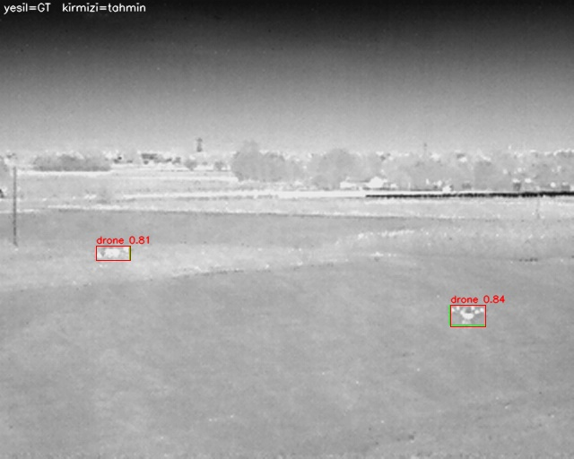	Gözlem sahasında 2 adet drone tespit edilmiştir.
11		Gözlem sahasında 19 adet person tespit edilmiştir.
12		Gözlem sahasında 10 adet person tespit edilmiştir.
13	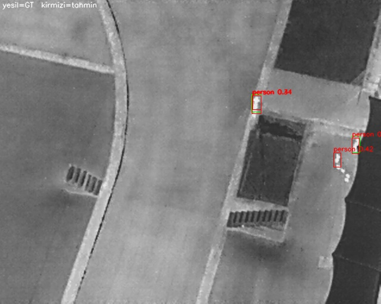	Gözlem sahasında 3 adet person tespit edilmiştir.
14		Gözlem sahasında 3 adet person tespit edilmiştir.
15	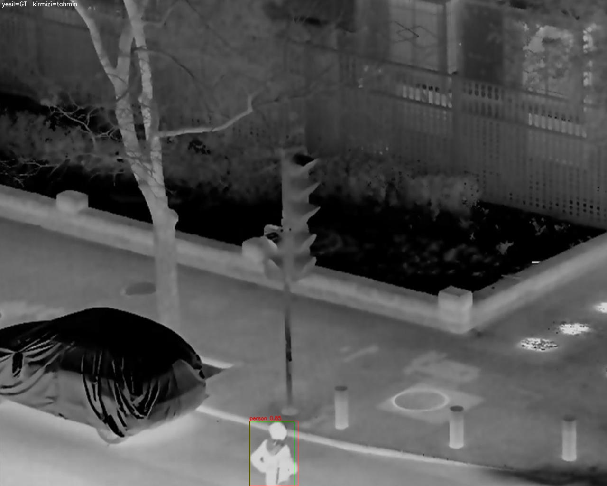	Gözlem sahasında 1 adet person tespit edilmiştir.
16	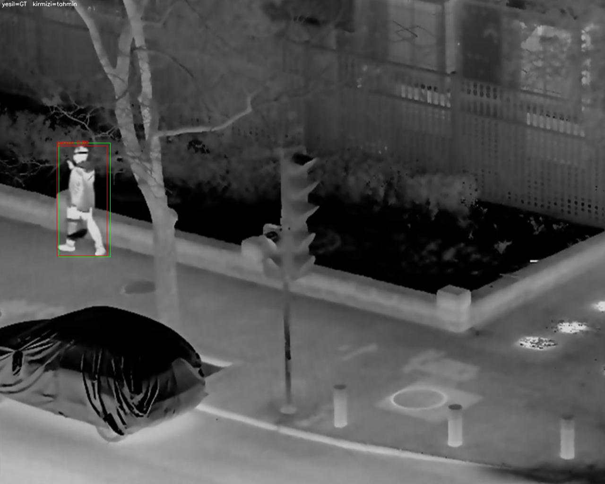	Gözlem sahasında 1 adet person tespit edilmiştir.
17		Gözlem sahasında 4 adet person tespit edilmiştir.
18		Gözlem sahasında 2 adet person tespit edilmiştir.
19		Gözlem sahasında 2 adet person tespit edilmiştir.
20		Gözlem sahasında 5 adet person tespit edilmiştir.

4.3. İki Modelin Raporlarının Ayrıştığı Örnekler (GT ile)
Örnek	Yer Doğruluğu (GT)	YOLOv8n Raporu	RT-DETR-L Raporu
02	5 nesne (0 küçük)	4 adet car ve 1 adet person	6 adet car ve 2 adet person
03	8 nesne (0 küçük)	4 adet car ve 2 adet person	4 adet car ve 6 adet person
04	5 nesne (0 küçük)	3 adet car ve 2 adet person	3 adet car ve 3 adet person
09	1 nesne (1 küçük)	2 adet drone	1 adet drone
11	9 nesne (9 küçük)	17 adet person	19 adet person
13	2 nesne (2 küçük)	4 adet person	3 adet person
> GT sayıları `ornek_ciktilar/index.csv` dosyasındaki `n_gt` ve `n_gt_small` sütunlarındandır. Rapordaki toplam nesne sayısı GT ile karşılaştırıldığında YOLOv8n örnek **02** ve **04**'te, RT-DETR-L örnek **09** ve **13**'te GT'ye daha yakındır; **03**'te iki model de GT'den 2 nesne sapar; **11**'de ikisi de GT'nin (9) çok üstündedir (17 ve 19). Karşılaştırma yalnız sayı düzeyindedir, kutu eşleşmesi yapılmamıştır. Modül güven eşiğini (`0.25`) aşan tüm tespitleri saydığı için fazla tespitler rapor cümlesine doğrudan yansır.
---
5. YOLOv8n vs. RT-DETR-L Karşılaştırmalı Test Sonuçları
Aynı veri bölmesi (`da43dd521edebb0d`) ve aynı bağımsız test kümesi (`2974 görüntü`, `9611 nesne`, `2295 küçük nesne`) üzerinde iki mimarinin karşılaştırmalı performans özeti aşağıdadır. Fark sütunları mutlak metrik farkını (yüzde puan) gösterir.
5.1. Genel Karşılaştırma
Metrik / Kriter	YOLOv8n (CNN)	RT-DETR-L (Transformer)	Fark (RT-DETR-L - YOLOv8n)
mAP@50 (Genel)	0.8970	0.9119	`+0.0149` (+1.49 puan)
mAP@50-95 (Genel)	0.6221	0.6684	`+0.0463` (+4.63 puan)
AP_small@50 (`<32x32 px`)	0.7631	0.7964	`+0.0333` (+3.33 puan)
AP_small@50-95 (`<32x32 px`)	0.4491	0.5306	`+0.0815` (+8.15 puan)
Çıkarım Süresi (Inference)	1.3 ms	8.1 ms	`+6.8 ms`
Ön / Son İşlem (Pre / Postprocess)	0.6 ms / 0.9 ms	0.6 ms / 0.2 ms	`0.0 ms / -0.7 ms`
Toplam Süre (Görüntü Başına)	2.8 ms	8.9 ms	`+6.1 ms`
Parametre Sayısı / GFLOPs (fused)	3.133.922 / 8.6	31.996.070 / 105.4	`+28.862.148 / +96.8`
5.2. Sınıf Bazlı Karşılaştırma (YOLOv8n / RT-DETR-L)
Her hücrede `YOLOv8n / RT-DETR-L` değeri, altında RT-DETR-L − YOLOv8n farkı verilmiştir. Kalın değer, ilgili metrikte daha yüksek olan modeli gösterir.
Sınıf	mAP@50	mAP@50-95	AP_small@50	AP_small@50-95
`person`	0.9677 / 0.9803 `+0.0126`	0.6617 / 0.6863 `+0.0246`	0.9283 / 0.9652 `+0.0369`	0.5166 / 0.5531 `+0.0365`
`car`	0.9889 / 0.9885 `-0.0004`	0.9062 / 0.8836 `-0.0226`	0.8832 / 0.8474 `-0.0358`	0.5523 / 0.5543 `+0.0020`
`bicycle`	0.8811 / 0.9201 `+0.0390`	0.5175 / 0.5892 `+0.0717`	0.8265 / 0.9009 `+0.0744`	0.4465 / 0.5471 `+0.1006`
`other_vehicle`	0.5917 / 0.6273 `+0.0356`	0.3568 / 0.4348 `+0.0780`	0.0000 / 0.1111 `+0.1111`	0.0000 / 0.0667 `+0.0667`
`drone`	0.9575 / 0.9627 `+0.0052`	0.6589 / 0.6883 `+0.0294`	0.9407 / 0.9550 `+0.0143`	0.5795 / 0.6164 `+0.0369`
`mine`	0.9949 / 0.9921 `-0.0028`	0.6316 / 0.7280 `+0.0964`	1.0000 / 0.9986 `-0.0014`	0.5999 / 0.8462 `+0.2463`
5.3. COCO Protokolü ile Çapraz Kontrol
Ultralytics'in kendi mAP hesabı ile `pycocotools` (101 nokta interpolasyon) sonuçlarında iki protokolde de model sıralaması değişmemektedir; ancak fark büyüklüğü protokole göre değişir: `mAP@50` farkı Ultralytics'te `+0.0149`, COCO protokolünde `+0.0469`'dur. Bunun nedeni COCO değerinin YOLOv8n'de Ultralytics değerinden `0.0346` düşük, RT-DETR-L'de yalnızca `0.0026` düşük çıkmasıdır:
Metrik	YOLOv8n Ultralytics	YOLOv8n COCO	RT-DETR-L Ultralytics	RT-DETR-L COCO	Fark (COCO, RT-DETR-L - YOLOv8n)
mAP@50	0.8970	0.8624	0.9119	0.9093	`+0.0469`
mAP@50-95	0.6221	0.6037	0.6684	0.6662	`+0.0625`
> **Karşılaştırmalı Değerlendirme:** RT-DETR-L, özellikle `<32x32 px` boyutundaki küçük hedeflerde (`AP_small@50-95` metriğinde **+8.15 puan**) ve genel kutu hizalama hassasiyetinde (`mAP@50-95` metriğinde **+4.63 puan**) CNN tabanlı YOLOv8n mimarisine kıyasla belirgin üstünlük sağlamıştır. Üstünlük `person`, `bicycle`, `drone` ve `other_vehicle` sınıflarında tutarlıdır; `car` sınıfında ise YOLOv8n, `mAP@50-95` (`0.9062` - `0.8836`) ve `AP_small@50` (`0.8832` - `0.8474`) metriklerinde daha yüksektir. `mine` sınıfında `mAP@50` değerleri pratikte eşittir (`0.9949` - `0.9921`), RT-DETR-L farkı daha sıkı IoU eşiklerinde ortaya çıkmaktadır (`mAP@50-95`: `+0.0964`).

5.4. Doğrulama (Val) ve Test Sonuçları
Model	Val mAP@50	Val mAP@50-95	Test mAP@50	Test mAP@50-95
YOLOv8n	0.844	0.548	0.8970	0.6221
RT-DETR-L	0.883	0.615	0.9119	0.6684
> Test kümesindeki değerler eğitim sonu doğrulama değerlerinden yüksektir. `val` kümesinde küçük nesne oranının daha yüksek olması (`%29.50` ve `%23.88`) bunun bir nedeni olabilir, ancak bu çalışmada ayrıca sınanmamıştır; bu nedenle `val` ve `test` değerleri doğrudan birbirinin yerine kullanılmamalıdır.
5.5. Literatürle Karşılaştırma
Çalışma	Veri Seti	Mimari	Ölçüt	Sonuç
PHSI-RTDETR (S. Wang vd., 2024)	HIT-UAV (termal)	RT-DETR tabanlı, hafif	mAP@50	%82.58
MFF-DCNet (Z. Wang vd., 2026)	HIT-UAV (termal)	Transformer tabanlı (DCFormer + MFF)	AP@50-95	%57.4
YOLO-UIR (C. Wang vd., 2025)	HIT-UAV (termal)	YOLO tabanlı, hafif	mAP (eşik belirtilmemiş)	%90.7
DFAS-YOLO (Liu vd., 2025)	HIT-UAV (termal)	YOLOv8s tabanlı	mAP@50	%78.5
ELNet (Li vd., 2025)	HIT-UAV (termal)	YOLOv12n tabanlı	mAP@50	%94.7
Drone-DETR (Kong vd., 2024)	VisDrone2019 (görünür bant)	RT-DETR tabanlı	mAP@50	%53.9
Bu çalışma	Birleştirilmiş 6 sınıflı termal veri seti, sızıntısız test (2.974 görüntü)	YOLOv8n	mAP@50 / mAP@50-95	%89.7 / %62.2
Bu çalışma	Birleştirilmiş 6 sınıflı termal veri seti, sızıntısız test (2.974 görüntü)	RT-DETR-L	mAP@50 / mAP@50-95	%91.2 / %66.8
> **Not:** Değerler ilgili makalelerde raporlandığı şekliyle verilmiştir. Veri setleri, bölme protokolleri, giriş çözünürlüğü, değerlendirme araçları ve ölçüt tanımları farklı olduğundan sayılar **doğrudan karşılaştırılamaz**. YOLO-UIR makalesinde mAP için IoU eşiği belirtilmemiştir; MFF-DCNet değeri AP@50-95 ölçütündedir. Bu tablo bir sıralama olarak değil, sonuçların termal İHA literatüründe bildirilen değer aralığıyla tutarlı olduğunu gösteren bir bağlam olarak yorumlanmalıdır; adil bir karşılaştırma ancak modellerin aynı bölmede yeniden eğitilmesiyle mümkündür.
---
6. Hata Analizi ve Kısıtlar (Error Analysis & Limitations)
Bağımsız test kümesi (`2974 görüntü`, `9611 nesne`) ve örnek çıktılar incelendiğinde, her iki mimarinin güçlü genelleme performansının yanı sıra sahaya ve mimariye özgü belirli hata modları ile kısıtlar tespit edilmiştir:
Küçük ve Zor Hedeflerde False Negative (Kaçırılan Tespit): İHA irtifasının yükseldiği sahnelerde hedef alanı küçüldüğünde, CNN tabanlı YOLOv8n'in alt örnekleme (downsampling) katmanlarında uzamsal öznitelik kaybı yaşanması beklenmektedir; bu bir hipotezdir ve bu çalışmada ayrıca sınanmamıştır. Ölçülen dayanak recall değerleridir: test kümesinde genel recall YOLOv8n için `0.789`, RT-DETR-L için `0.877`; `other_vehicle` sınıfında `0.0836` ve `0.421`. Örnek çıktılarda sayı düzeyinde bakıldığında (kutu eşleşmesi yapılmamıştır) örnek 03'te GT 8 nesne iken YOLOv8n 6, RT-DETR-L 10; örnek 11'de GT 9 nesne iken YOLOv8n 17, RT-DETR-L 19 nesne raporlamıştır. Yani 11'de her iki model GT'nin çok üstündedir ve bu karede sorun kaçırma değil fazla tespit (olası yanlış alarm veya tekrar) yönündedir; bu örnekler RT-DETR-L'nin daha yüksek recall sağladığını göstermez. Çok düşük kontrastlı arka planlarda her iki modelde de kaçırılan hedeflerin oluşabileceği beklenmektedir.
Termal Yansımalar ve Arka Plan Karmaşasında False Positive (Yanlış Alarm) Oluşumu: Gün içi güneş ışınımını soğuran zemin dokuları, sıcak araç aksamları veya gökyüzü/bulut geçişlerindeki ani yoğunluk değişimleri, termal ve EO spektrumda küçük hedeflerle benzer parlaklık dağılımı sergileyebilmektedir. Örneğin 02 numaralı karede GT 5 nesne iken YOLOv8n 5 nesne (4 `car`, 1 `person`), RT-DETR-L ise 8 nesne (6 `car`, 2 `person`) raporlamıştır; RT-DETR-L'nin GT'nin üstündeki 3 fazladan tespitinin bir kısmı arka plandaki ikincil nesnelerden/yansımalardan kaynaklanıyor olabilir ve GT kutularıyla karşılaştırılarak doğrulanmalıdır. Bu nedenle bu gözlem kesin bir False Positive ölçümü değil, olası bir hata modu olarak değerlendirilmelidir.
Sınıf Dengesizliği ve Nadir Sınıflarda Genelleme Kısıtı: Birleştirilmiş veri setinde `person` (`n=6605`) ve `car` (`n=1906`) sınıfları baskın iken `other_vehicle` (`n=19`) sınıfı oldukça sınırlı sayıda örneğe sahiptir. Bu dengesizlik, `other_vehicle` sınıfında küçük nesne başarımının (`AP_small@50-95`) YOLOv8n'de `0.0000`, RT-DETR-L'de ise `0.0667` seviyesinde kalmasına neden olmuştur. Ayrıca yazarın ön gözlemine göre örnek sayısının azlığı nedeniyle genel `mAP@50` ortalamasını düşürdüğü için veri setinden çıkarılan `gun` sınıfı (`1.839` görüntü; çıkarma öncesi ölçüm bu depoda yer almamaktadır), sonuçların `gun` sınıfını içeren çalışmalarla doğrudan karşılaştırılabilirliğini sınırlandırmaktadır.
Küçük Örneklem Kaynaklı İstatistiksel Belirsizlik: `other_vehicle` sınıfında yalnızca 1 küçük nesne, `car` sınıfında 44 küçük nesne bulunmaktadır; dolayısıyla bu sınıflara ait `AP_small` değerleri istatistiksel olarak güvenilir bir karşılaştırma sunmaz. Benzer şekilde `mine` sınıfındaki `+0.2463` `AP_small@50-95` farkı yalnızca `79` küçük nesneye dayanmaktadır. Sonuçlar tek bir eğitim koşusuna aittir; farklı rastgele tohumlarla tekrar edilen eğitimler ve güven aralıkları, farkların kalıcılığını doğrulamak için gelecek çalışmada eklenmelidir.
Mimari Hesaplama Maliyeti ve Donanım Kısıtları (RT-DETR-L vs. YOLOv8n): RT-DETR-L (315 katman, 31.996.070 parametre, 105.4 GFLOPs), küçük nesne konumlandırmada (`AP_small@50-95` farkı `+8.15 puan`) üstünlük sağlamaktadır; bunun küresel öz-dikkat (self-attention) mekanizmasından ve NMS-free (Non-Maximum Suppression gerektirmeyen) uçtan uca yapısından kaynaklandığı düşünülmektedir, ancak bu çalışmada ablasyon yapılmamıştır ve model kapasiteleri eşit değildir (YOLOv8n ve RT-DETR-L). Buna karşılık YOLOv8n (73 katman, 3.133.922 parametre, 8.6 GFLOPs), yaklaşık 10 kat daha az parametre ve NVIDIA L4 GPU üzerinde görüntü başına 1.3 ms çıkarım / 2.8 ms toplam süresiyle (8.1 ms çıkarım / 8.9 ms toplam süreye sahip RT-DETR-L'ye kıyasla çıkarımda ~6.2 kat, toplam sürede ~3.2 kat daha hızlı) güç ve bellek bütçesi kısıtlı yerleşik İHA uçuş bilgisayarlarında (ör. NVIDIA Jetson Nano/Orin) gerçek zamanlı FPS gereksinimleri için daha hafif bir alternatif sunmaktadır. (Not: Süreler NVIDIA L4 üzerinde, YOLOv8n için `batch=16` ve RT-DETR-L için `batch=4, half=True` ayarlarıyla tek koşuda alınmış yaklaşık göstergelerdir; gömülü İHA donanımında doğrudan ölçüm yapılmamıştır.)
Val ve Test Kümeleri Arasındaki Küçük Nesne Oranı Farkı: Yakın-kopya gruplarının bütünlüğü bozulmadan yalnızca sınıf etiketlerine göre yapılan katmanlı bölme sonucunda küçük nesne oranı `val` kümesinde `%29.50` (`2.673 / 9.060`), `test` kümesinde `%23.88` (`2.295 / 9.611`) olarak gerçekleşmiştir. Bu fark, `val` kümesindeki `mAP@50` değerlerinin (YOLOv8n: `0.844`; RT-DETR-L: `0.883`) test sonuçlarından (`0.8970` ve `0.9119`) düşük çıkmasıyla ilişkili olabilir. İleride sınıf etiketlerinin yanı sıra nesne boyut kategorilerini (küçük, orta, büyük) de eş zamanlı dengeleyen çok değişkenli katmanlı örnekleme kullanılmalıdır.
Doğal Dil Modülünün Kapsamı: Kural tabanlı modül yalnızca sınıf sayılarını aktarır; nesneler arasındaki konumsal ve mekânsal ilişkileri (ör. "sol üstte", "birbirine yakın") betimleyememektedir.
---
7. Tekrarlanabilirlik (Reproducibility)
Öğe	YOLOv8n	RT-DETR-L
Eğitim koşusu	`uav_thermal_6cls`	`uav_rtdetr_6cls`
Ağırlık dosyası	`runs/uav_thermal_6cls/weights/best.pt`	`runs/uav_rtdetr_6cls/weights/best.pt`
Mimari karmaşıklık (fused)	`73 katman / 3.133.922 param. / 8.6 GFLOPs`	`315 katman / 31.996.070 param. / 105.4 GFLOPs`
Eğitim (epoch / batch / süre)	`25 epoch / batch 32 / 1.099 saat`	`30 epoch / batch 16 / 6.448 saat`
Bölme parmak izi	`da43dd521edebb0d`	`da43dd521edebb0d`
Test kümesi	`2974 görüntü / 9611 nesne (2295 küçük)`	`2974 görüntü / 9611 nesne (2295 küçük)`
Ortam	Google Colab, NVIDIA L4, Ultralytics 8.4.211, PyTorch 2.14.1	Google Colab, NVIDIA L4, Ultralytics 8.4.211, PyTorch 2.14.1
Başlangıç ağırlıkları	COCO ön eğitimli, sınıf başlığı 6 sınıfa uyarlanmış	COCO ön eğitimli, sınıf başlığı 6 sınıfa uyarlanmış
Optimizer	AdamW (Ultralytics otomatik seçimi), lr = 0.001	AdamW (Ultralytics otomatik seçimi), lr = 0.001
Veri artırma	Ultralytics varsayılanları (mosaic 1.0, yatay çevirme 0.5, HSV, randaugment, erasing 0.4)	Ultralytics varsayılanları (mosaic 1.0, yatay çevirme 0.5, HSV, randaugment, erasing 0.4)
Seed / deterministic	`seed=42`, `deterministic=True`	`seed=42`, `deterministic=False` (bazı CUDA işlemleri deterministik değil)
Test protokolü	`imgsz=640`, `conf=0.001`, `iou=0.7`, `max_det=300`, `batch=16`	`imgsz=640`, `conf=0.001`, `iou=0.7` (NMS kullanılmadığı için etkisiz), `max_det=300`, `batch=4`, `half=True`
Küçük nesne tanımı	COCO alan ≤ 1024 px, `maxDets=300`	COCO alan ≤ 1024 px, `maxDets=300`
Güven eşiği (görselleştirme)	`conf >= 0.25`	`conf >= 0.25`
Metrik kaynakları	`ultralytics` (mAP), `pycocotools` (AP_small, çapraz kontrol)	`ultralytics` (mAP), `pycocotools` (AP_small, çapraz kontrol)
Her iki modelin metrik dosyaları aynı bölme parmak iziyle üretilmiştir; bu sayede sonuçlar aynı test kümesi üzerinde doğrudan karşılaştırılabilir.

---
8. Gelecek Çalışmalar
`other_vehicle` gibi azınlık sınıflar için sentetik veri üretimi, hedefli veri artırma veya ek açık kaynak veri setlerinden örnek toplama.
Küçük nesne tespitini iyileştirmek için yüksek çözünürlüklü dilimleme (SAHI) yöntemlerinin denenmesi.
Modellerin eşit kapasitede karşılaştırılması; farklı rastgele tohumlarla (seed) tekrarlanan eğitimler, ortalama değerler ve güven aralıkları.
Gömülü donanımda (ör. Jetson sınıfı) doğrudan hız ölçümü.
Sınıf etiketleriyle birlikte nesne boyut kategorilerini de dengeleyen çok değişkenli katmanlı bölme.
İHA hava perspektifinden çekilmiş, ardışık kare sızıntısından arındırılmış ve yeterli örneklem büyüklüğüne sahip verilerle `gun` sınıfının yeniden değerlendirmeye alınması.
Kural tabanlı raporlama modülüne koordinat veya bölge tabanlı mekânsal betimlemelerin eklenmesi.
---
9. Kaynaklar (Literatür Karşılaştırması)
Kong, Y., Shang, X., & Jia, S. (2024). Drone-DETR: Efficient Small Object Detection for Remote Sensing Image Using Enhanced RT-DETR Model. Sensors, 24(17), 5496. https://doi.org/10.3390/s24175496
Li, H., Ma, J., & Zhang, J. (2025). ELNet: An Efficient and Lightweight Network for Small Object Detection in UAV Imagery. Remote Sensing, 17(12), 2096. https://doi.org/10.3390/rs17122096
Liu, X., Zhou, S., Ma, J., Sun, Y., Zhang, J., & Zuo, H. (2025). DFAS-YOLO: Dual Feature-Aware Sampling for Small-Object Detection in Remote Sensing Images. Remote Sensing, 17(20), 3476. https://doi.org/10.3390/rs17203476
Wang, C., Wang, R., Wu, Z., Bian, Z., & Huang, T. (2025). YOLO-UIR: A Lightweight and Accurate Infrared Object Detection Network Using UAV Platforms. Drones, 9(7), 479. https://doi.org/10.3390/drones9070479
Wang, S., Jiang, H., Li, Z., Yang, J., Ma, X., Chen, J., & Tang, X. (2024). PHSI-RTDETR: A Lightweight Infrared Small Target Detection Algorithm Based on UAV Aerial Photography. Drones, 8(6), 240. https://doi.org/10.3390/drones8060240
Wang, Z., Yu, P., Zhang, X., & Sun, H. (2026). MFF-DCNet: A Network With Multifeature Focus and Depth-Wise Cross-Stage Transformer for UAV Infrared Small-Object Detection. IEEE Internet of Things Journal, 13(10). https://doi.org/10.1109/JIOT.2025.3642607
