# Elektro-Optik ve Termal İHA Görüntülerinde Küçük Hedeflerin Derin Öğrenme ile Tespiti ve Doğal Dilde Raporlanması

Bu proje; İnsansız Hava Araçlarından (İHA) alınan elektro-optik (EO) ve termal görüntülerde küçük hedeflerin tespit edilmesini, sınıflandırılmasını ve elde edilen sonuçların operasyonel durum raporu olarak doğal dilde sunulmasını amaçlamaktadır. Çalışmada CNN tabanlı **YOLOv8** ile Transformer tabanlı **RT-DETR** mimarileri, sızıntısız (leakage-free) bağımsız bir test kümesinde karşılaştırılmıştır.

---

## Sistem Mimarisi ve İş Akışı

<pre>
┌───────────────────────────────────────────────────────────────────────┐
│             Birleştirilmiş İHA Veri Seti (EO ve Termal)               │
└───────────────────────────────────┬───────────────────────────────────┘
                                    │
                                    ▼
┌───────────────────────────────────────────────────────────────────────┐
│  Veri Sızıntısı Kontrolü ve Sequence Bölme (MD5 / Hamming / NCC)      │
│  Bölme Parmak İzi: da43dd521edebb0d                                   │
└───────────────────┬───────────────────────────────────┬───────────────┘
                    │                                   │
                    ▼                                   ▼
      ┌───────────────────────────┐       ┌───────────────────────────┐
      │   Eğitim & Doğrulama      │       │   Bağımsız Test Kümesi    │
      │   (Train & Val)           │       │   (Test: 2974 Görüntü)    │
      └─────────────┬─────────────┘       └─────────────┬─────────────┘
                    │                                   │
          ┌─────────┴─────────┐                         │
          │                   │                         │
          ▼                   ▼                         │
  ┌───────────────┐   ┌───────────────┐                 │
  │ 1. Mimari:    │   │ 2. Mimari:    │                 │
  │ YOLOv8 (CNN)  │   │ RT-DETR (ViT) │                 │
  └───────┬───────┘   └───────┬───────┘                 │
          │                   │                         │
          └─────────┬─────────┘                         │
                    │                                   │
                    └─────────────────┬─────────────────┘
                                      │
                                      ▼
┌───────────────────────────────────────────────────────────────────────┐
│  Test Değerlendirmesi ve Kıyaslama (mAP@50, mAP@50-95, AP_small)      │
└───────────────────┬───────────────────────────────────┬───────────────┘
                    │                                   │
                    ▼                                   ▼
      ┌───────────────────────────┐       ┌───────────────────────────┐
      │ Performans Metrikleri     │       │ Tespit Edilen Sınıflar    │
      │ (metrics_test.csv)        │       │ ['person', 'car', ...]    │
      └───────────────────────────┘       └─────────────┬─────────────┘
                                                        │
                                                        ▼
                                          ┌───────────────────────────┐
                                          │ Doğal Dil Modülü          │
                                          │ (report_generator.py)     │
                                          └─────────────┬─────────────┘
                                                        │
                                                        ▼
                                          ┌───────────────────────────┐
                                          │ Türkçe Durum Raporu       │
                                          │ (20 Örnek Çıktı)          │
                                          └───────────────────────────┘
</pre>

---

## 1. Veri Seti ve Kümeler

Aşağıdaki tabloda, kümeler arası veri sızıntısını (data leakage) önlemek amacıyla uçuş/dizi (`sequence`) bazlı olarak yeniden ayrılan birleştirilmiş İHA veri setinin (`merged_uav_dataset`) test kümesine ait görüntü ve etiket dağılımları yer almaktadır:

| Küme (Split) | Görüntü Sayısı | Etiket (`.txt`) Sayısı | Toplam Kutu (Instances) | Küçük Kutu (`<32x32 px`) | Genel Küçük Oranı (%) |
| :--- | :---: | :---: | :---: | :---: | :---: |
| **Test** | 2974 | 2974 (97 arka plan) | 9611 | 2295 | %23.88 |

Test kümesinin sınıf bazlı dağılımı aşağıdadır (küçük nesne: COCO tanımıyla alan ≤ 1024 px):

| Sınıf ID | Sınıf Adı | Örnek Sayısı | Küçük Nesne Sayısı | Sınıf İçi Küçük Oranı (%) |
| :---: | :--- | :---: | :---: | :---: |
| 0 | `person` | 6605 | 1568 | %23.74 |
| 1 | `car` | 1906 | 44 | %2.31 |
| 2 | `bicycle` | 515 | 350 | %67.96 |
| 3 | `other_vehicle` | 19 | 1 | %5.26 |
| 4 | `drone` | 383 | 253 | %66.06 |
| 5 | `mine` | 183 | 79 | %43.17 |
| | **Toplam** | **9611** | **2295** | **%23.88** |

---

## 2. Kümeler Arası Veri Sızıntısı (Data Leakage) Kontrolü ve Çözümü

İlk aşamada yapılan MD5 (birebir eşleşme) ve dHash (algısal benzerlik) kontrollerinde tespit edilen sızıntılar giderilmiş, veri seti yeniden yapılandırılmış ve son doğrulama testleri tamamlanmıştır:

- **Önceki Durum:** Kümeler rastgele bölündüğü için 2 adet birebir aynı (MD5) ve 453.198 adet çok benzer (`dHash <= 5`) ardışık video karesi çakışması tespit edilmişti.
- **Uygulanan Çözüm:** Adil ve akademik olarak güvenilir bir değerlendirme sağlamak amacıyla tüm veri seti uçuş/video dizisi (`sequence ID`) bazlı olarak yeniden `train`, `val` ve `test` kümelerine ayrılmıştır.
- **Son Doğrulama Sonuçları (MD5 / Hamming / NCC):**
  * **Birden Fazla Kümeye Dağılmış Grup:** `0`
  * **Kümeler Arası Birebir Kopya (MD5):** `0`
  * **Kümeler Arası Yakın Kopya:** `0`
  * **Farklı Kümelerde Aynı Dosya Adı:** `0`
  * **Küme Çiftleri Arası Maksimum Benzerlik (NCC, Ham<=10):**
    * `val -> train`: `0.995`
    * `test -> train`: `1.000`
    * `test -> val`: `0.976`
  * **Doğrulama Çıktısı:** `SIZINTI YOK - train/val/test ayrık` (**Bölme Parmak İzi / Split Fingerprint:** `da43dd521edebb0d`)

> **Not:** `test -> train` NCC değerinin `1.000` çıkması, farklı sequence'lerde görsel olarak benzer sahnelerin (ör. aynı kamera düzeneği veya sabit arka plan) bulunabildiğini göstermektedir. Bu durum aynı dosya veya aynı uçuş dizisinin kümeler arasında paylaşıldığı anlamına gelmez; yukarıdaki MD5, yakın kopya ve dosya adı kontrolleri `0` sonuç vermiştir.

---

## 3. Doğal Dil Raporlama Modülü

Nesne tespit modellerinden alınan ham çıktıları operatör dostu Türkçe durum raporuna dönüştüren modüldür:

- **Kodun Bulunduğu Dosya:** `report_generator.py`
- **Girdi Formatı:** Sınıf adları ve tespit adedi içeren tespit listesi (Örn: `['person', 'person', 'car']`)
- **Çıktı Formatı:** Doğal dilde rapor cümlesi (Örn: `"Gözlem sahasında 2 adet person ve 1 adet car tespit edilmiştir."`)

---

## 4. Test Sonuçları ve 20 Örnek Çıktı (Küme: TEST — Sızıntısız)

*(Tüm örnek görsellerde **yeşil kutular** gerçek etiketleri (GT), **kırmızı kutular** `conf >= 0.25` eşiğindeki model tahminlerini temsil etmektedir.)*

### 4.1. YOLOv8 Test Sonuçları

#### Genel ve Küçük Nesne Başarım Tablosu (YOLOv8)

| Metrik | IoU Eşiği / Alan Tanımı | Değer |
| :--- | :--- | :---: |
| **mAP@50 (Genel)** | IoU = 0.50 | 0.8970 |
| **mAP@50-95 (Genel)** | IoU = 0.50:0.95 | 0.6221 |
| **AP_small@50 (`<32x32 px`)** | IoU = 0.50 (COCO area <= 1024px) | 0.7631 |
| **AP_small@50-95 (`<32x32 px`)** | IoU = 0.50:0.95 (COCO area <= 1024px) | 0.4491 |

#### Sınıf Bazlı Başarım Tablosu (YOLOv8)

| Sınıf ID | Sınıf Adı (Class Name) | Örnek Sayısı (Instances) | Küçük Nesne Sayısı (`<32x32 px`) | mAP@50 | mAP@50-95 | AP_small@50 | AP_small@50-95 |
| :---: | :--- | :---: | :---: | :---: | :---: | :---: | :---: |
| 0 | `person` | 6605 | 1568 | 0.9677 | 0.6617 | 0.9283 | 0.5166 |
| 1 | `car` | 1906 | 44 | 0.9889 | 0.9062 | 0.8832 | 0.5523 |
| 2 | `bicycle` | 515 | 350 | 0.8811 | 0.5175 | 0.8265 | 0.4465 |
| 3 | `other_vehicle` | 19 | 1 | 0.5917 | 0.3568 | 0.0000 | 0.0000 |
| 4 | `drone` | 383 | 253 | 0.9575 | 0.6589 | 0.9407 | 0.5795 |
| 5 | `mine` | 183 | 79 | 0.9949 | 0.6316 | 1.0000 | 0.5999 |

> **YOLOv8 Değerlendirme Notu:** Sızıntı öncesi (ardışık kare ezberli) dağılımda `%93.66` olan `mAP@50` değeri, sızıntılar tamamen temizlendikten sonra gerçek genelleme performansını yansıtarak `%89.70` olarak gerçekleşmiştir. Ana sınıfların (`person`, `car`, `drone`, `mine`) tamamı `%95.7–%99.5` bandında yüksek başarım sergilerken, `other_vehicle` sınıfındaki düşük skor test kümesindeki örnek azlığından (`n=19`) kaynaklanmaktadır.

#### YOLOv8 — Test Kümesinden Seçilen 20 Örnek Tespit ve Durum Raporları

| Örnek | Tespit Görseli (YOLOv8) | Doğal Dil Durum Raporu |
| :---: | :---: | :--- |
| **01** |  | Gözlem sahasında 6 adet person tespit edilmiştir. |
| **02** |  | Gözlem sahasında 4 adet car ve 1 adet person tespit edilmiştir. |
| **03** | 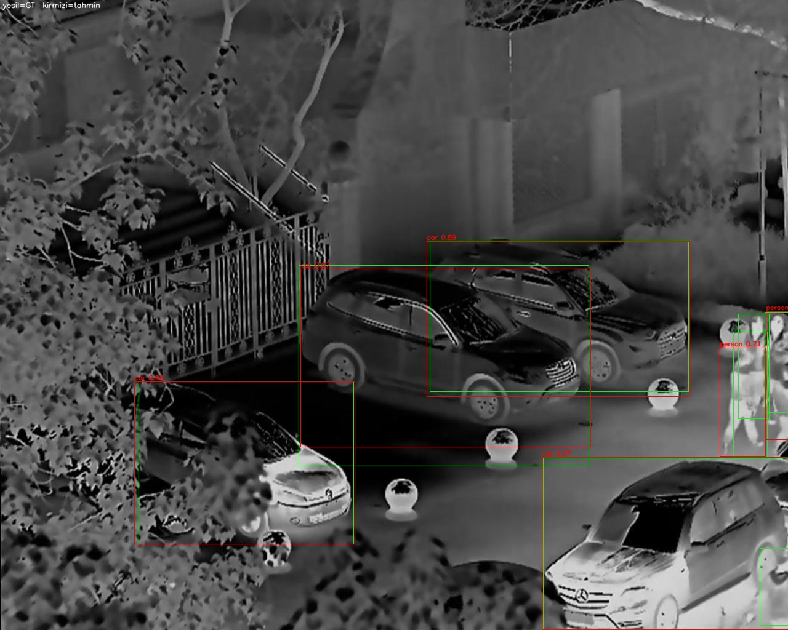 | Gözlem sahasında 4 adet car ve 2 adet person tespit edilmiştir. |
| **04** |  | Gözlem sahasında 3 adet car ve 2 adet person tespit edilmiştir. |
| **05** |  | Gözlem sahasında 1 adet drone tespit edilmiştir. |
| **06** | 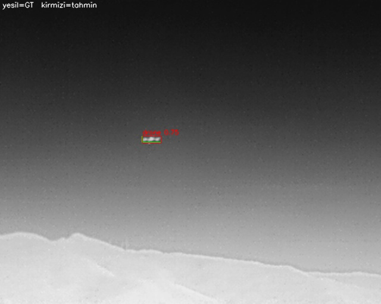 | Gözlem sahasında 1 adet drone tespit edilmiştir. |
| **07** |  | Gözlem sahasında 3 adet drone tespit edilmiştir. |
| **08** |  | Gözlem sahasında 2 adet drone tespit edilmiştir. |
| **09** |  | Gözlem sahasında 2 adet drone tespit edilmiştir. |
| **10** | 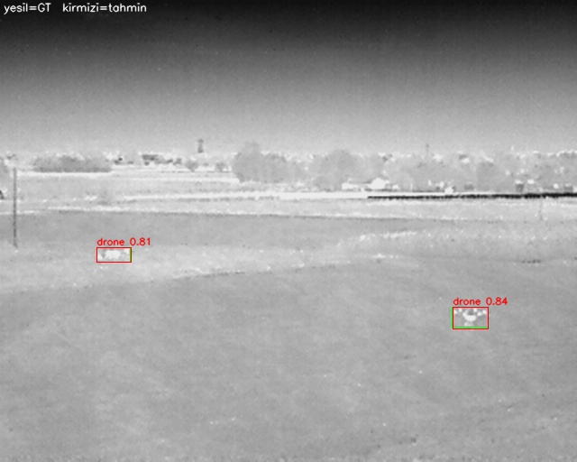 | Gözlem sahasında 2 adet drone tespit edilmiştir. |
| **11** | 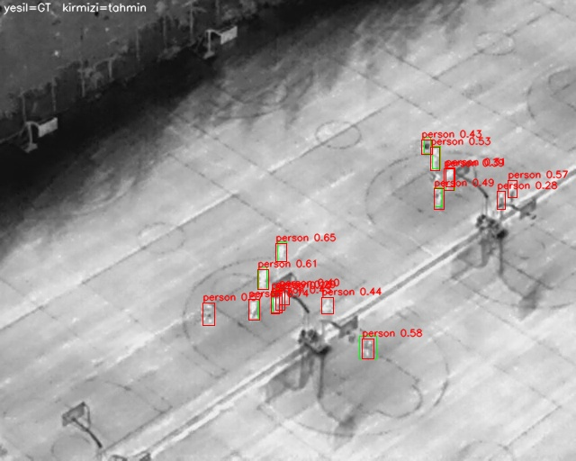 | Gözlem sahasında 17 adet person tespit edilmiştir. |
| **12** |  | Gözlem sahasında 10 adet person tespit edilmiştir. |
| **13** |  | Gözlem sahasında 4 adet person tespit edilmiştir. |
| **14** | 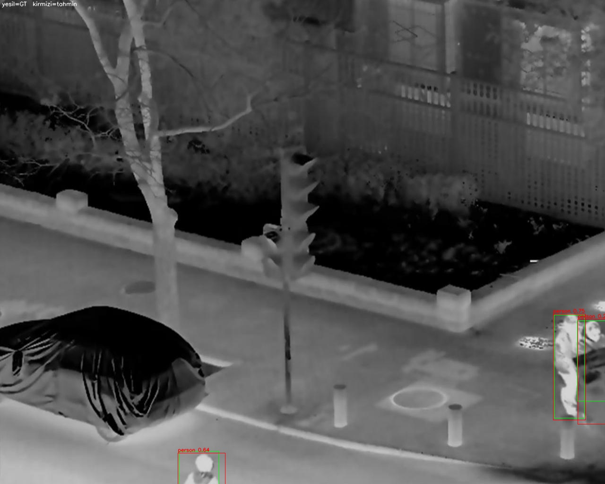 | Gözlem sahasında 3 adet person tespit edilmiştir. |
| **15** |  | Gözlem sahasında 1 adet person tespit edilmiştir. |
| **16** |  | Gözlem sahasında 1 adet person tespit edilmiştir. |
| **17** | 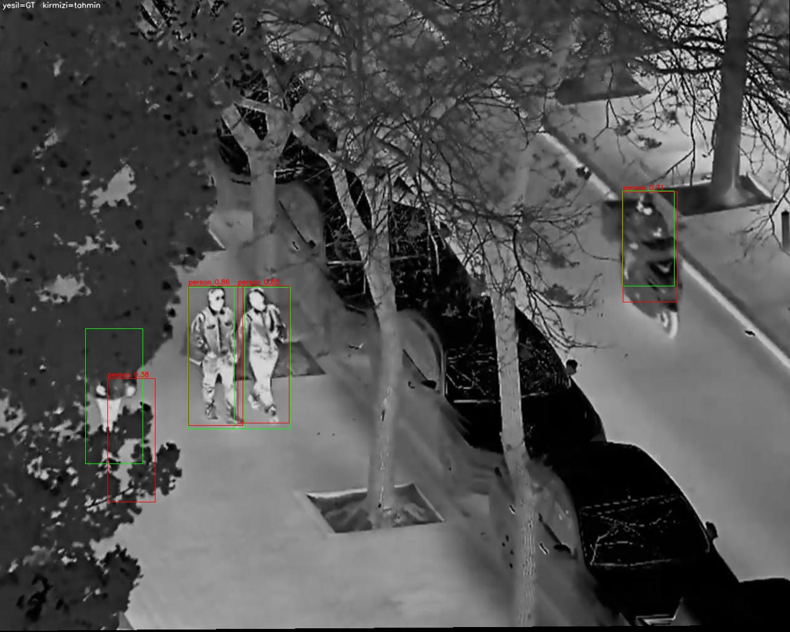 | Gözlem sahasında 4 adet person tespit edilmiştir. |
| **18** |  | Gözlem sahasında 2 adet person tespit edilmiştir. |
| **19** | 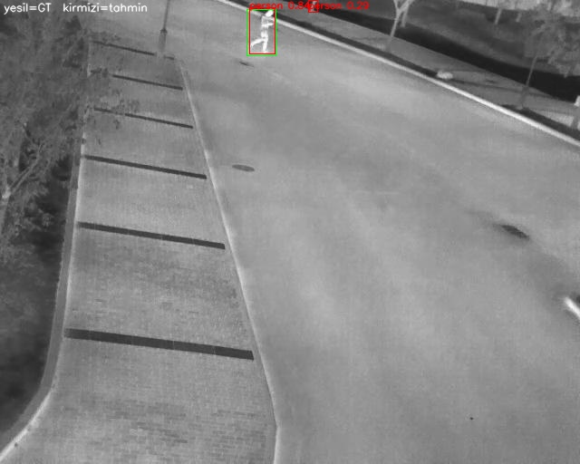 | Gözlem sahasında 2 adet person tespit edilmiştir. |
| **20** |  | Gözlem sahasında 5 adet person tespit edilmiştir. |

---

### 4.2. RT-DETR Test Sonuçları

#### Genel ve Küçük Nesne Başarım Tablosu (RT-DETR)

| Metrik | IoU Eşiği / Alan Tanımı | Değer |
| :--- | :--- | :---: |
| **mAP@50 (Genel)** | IoU = 0.50 | **0.9119** |
| **mAP@50-95 (Genel)** | IoU = 0.50:0.95 | **0.6684** |
| **AP_small@50 (`<32x32 px`)** | IoU = 0.50 (COCO area <= 1024px) | **0.7964** |
| **AP_small@50-95 (`<32x32 px`)** | IoU = 0.50:0.95 (COCO area <= 1024px) | **0.5306** |

#### Sınıf Bazlı Başarım Tablosu (RT-DETR)

| Sınıf ID | Sınıf Adı (Class Name) | Örnek Sayısı (Instances) | Küçük Nesne Sayısı (`<32x32 px`) | mAP@50 | mAP@50-95 | AP_small@50 | AP_small@50-95 |
| :---: | :--- | :---: | :---: | :---: | :---: | :---: | :---: |
| 0 | `person` | 6605 | 1568 | 0.9803 | 0.6863 | 0.9652 | 0.5531 |
| 1 | `car` | 1906 | 44 | 0.9885 | 0.8836 | 0.8474 | 0.5543 |
| 2 | `bicycle` | 515 | 350 | 0.9201 | 0.5892 | 0.9009 | 0.5471 |
| 3 | `other_vehicle` | 19 | 1 | 0.6273 | 0.4348 | 0.1111 | 0.0667 |
| 4 | `drone` | 383 | 253 | 0.9627 | 0.6883 | 0.9550 | 0.6164 |
| 5 | `mine` | 183 | 79 | 0.9921 | 0.7280 | 0.9986 | 0.8462 |

> **RT-DETR Değerlendirme Notu:** Transformer tabanlı öz-dikkat (self-attention) mimarisine sahip RT-DETR modeli, sızıntısız bağımsız test kümesinde `%91.19` genel `mAP@50` ve `%53.06` `AP_small@50-95` başarımına ulaşmıştır. Özellikle küçük hedeflerin yoğun olduğu `mine` (`AP_small@50-95 = 0.8462`), `drone` (`0.6164`) ve `bicycle` (`0.5471`) sınıflarında güçlü konumlandırma hassasiyeti sergilemiştir.

#### RT-DETR — Test Kümesinden Seçilen 20 Örnek Tespit ve Durum Raporları

| Örnek | Tespit Görseli (RT-DETR) | Doğal Dil Durum Raporu |
| :---: | :---: | :--- |
| **01** | 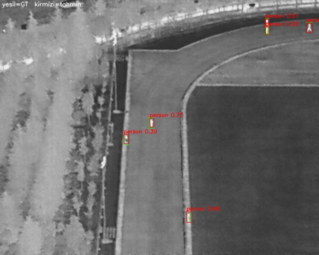 | Gözlem sahasında 6 adet person tespit edilmiştir. |
| **02** | 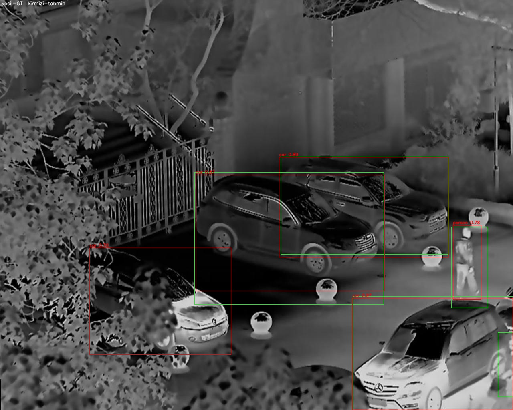 | Gözlem sahasında 6 adet car ve 2 adet person tespit edilmiştir. |
| **03** |  | Gözlem sahasında 4 adet car ve 6 adet person tespit edilmiştir. |
| **04** | 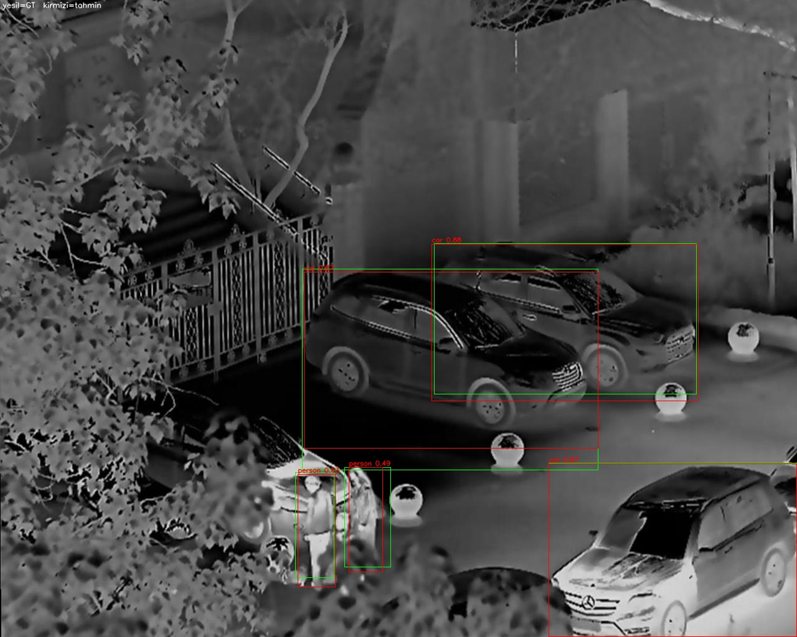 | Gözlem sahasında 3 adet car ve 3 adet person tespit edilmiştir. |
| **05** |  | Gözlem sahasında 1 adet drone tespit edilmiştir. |
| **06** |  | Gözlem sahasında 1 adet drone tespit edilmiştir. |
| **07** | 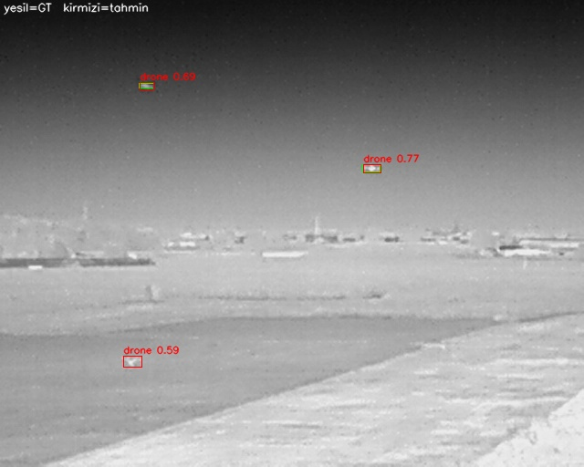 | Gözlem sahasında 3 adet drone tespit edilmiştir. |
| **08** |  | Gözlem sahasında 2 adet drone tespit edilmiştir. |
| **09** |  | Gözlem sahasında 1 adet drone tespit edilmiştir. |
| **10** |  | Gözlem sahasında 2 adet drone tespit edilmiştir. |
| **11** |  | Gözlem sahasında 19 adet person tespit edilmiştir. |
| **12** |  | Gözlem sahasında 10 adet person tespit edilmiştir. |
| **13** |  | Gözlem sahasında 3 adet person tespit edilmiştir. |
| **14** |  | Gözlem sahasında 3 adet person tespit edilmiştir. |
| **15** | 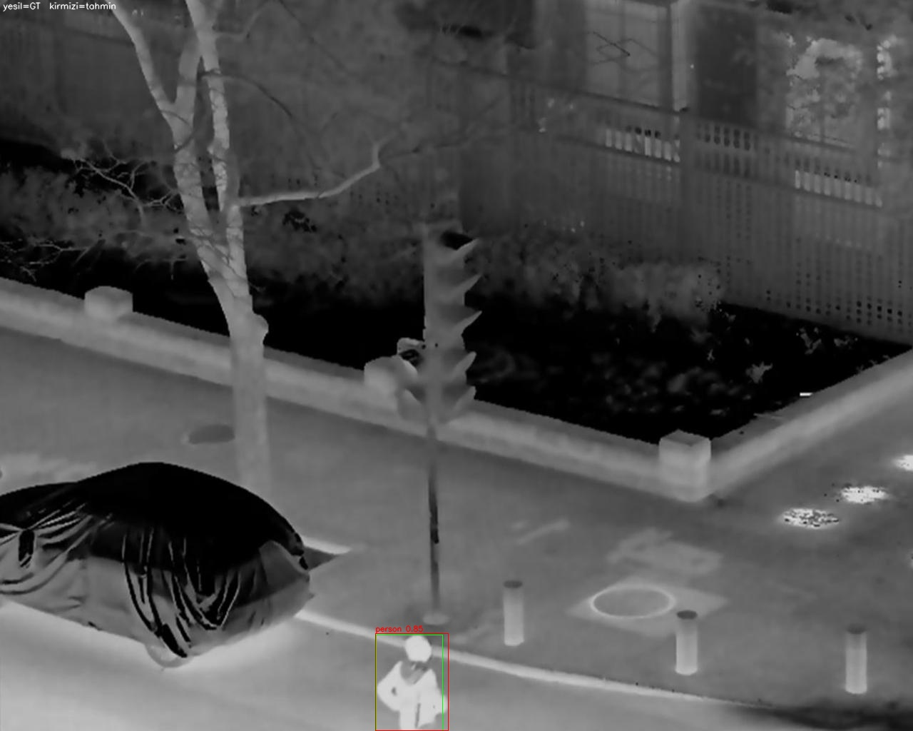 | Gözlem sahasında 1 adet person tespit edilmiştir. |
| **16** | 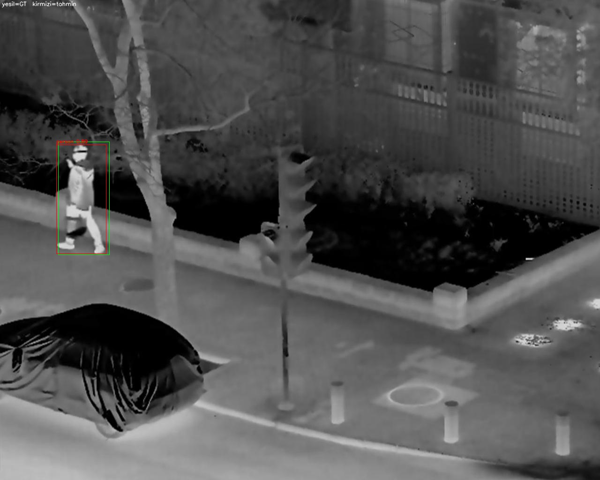 | Gözlem sahasında 1 adet person tespit edilmiştir. |
| **17** |  | Gözlem sahasında 4 adet person tespit edilmiştir. |
| **18** | 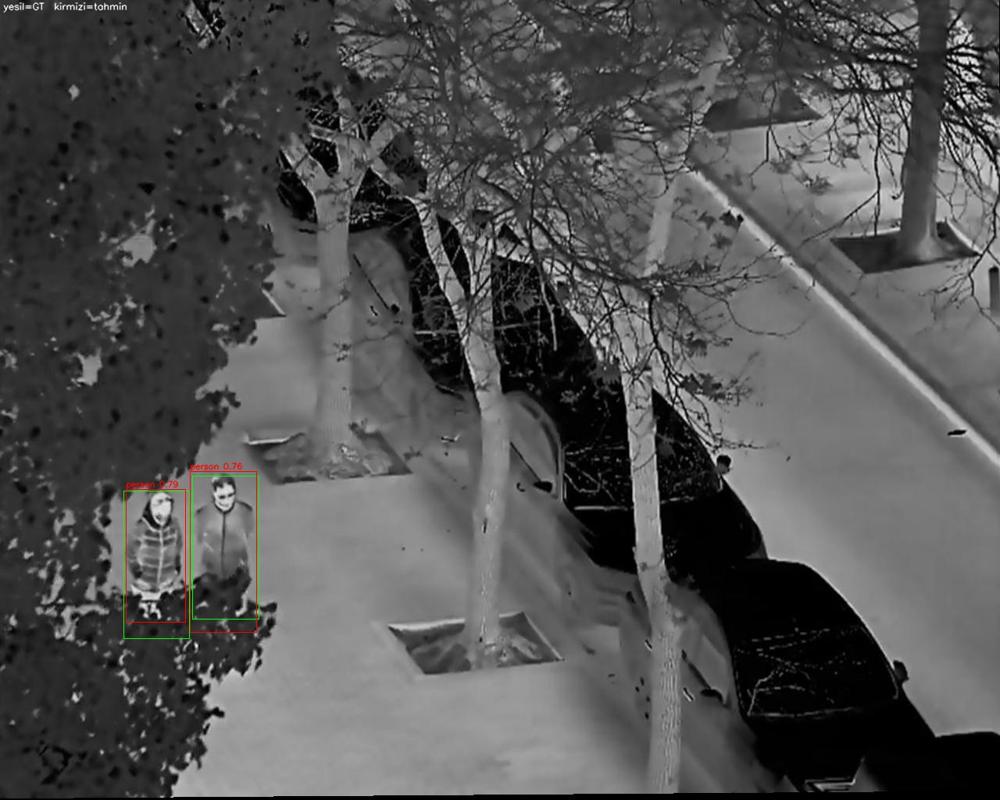 | Gözlem sahasında 2 adet person tespit edilmiştir. |
| **19** |  | Gözlem sahasında 2 adet person tespit edilmiştir. |
| **20** | 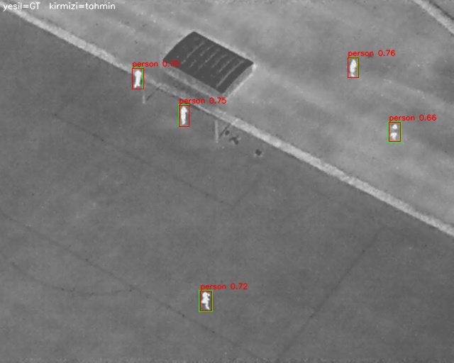 | Gözlem sahasında 5 adet person tespit edilmiştir. |

---

## 5. YOLOv8 vs. RT-DETR Karşılaştırmalı Test Sonuçları

Aynı veri bölmesi (`da43dd521edebb0d`) ve aynı bağımsız test kümesi (`2974 görüntü`, `9611 nesne`, `2295 küçük nesne`) üzerinde iki mimarinin karşılaştırmalı performans özeti aşağıdadır. Fark sütunları mutlak metrik farkını (yüzde puan) gösterir.

### 5.1. Genel Karşılaştırma

| Metrik / Kriter | YOLOv8 (CNN) | RT-DETR (Transformer) | Fark (RT-DETR - YOLOv8) |
| :--- | :---: | :---: | :---: |
| **mAP@50 (Genel)** | 0.8970 | **0.9119** | `+0.0149` (+1.49 puan) |
| **mAP@50-95 (Genel)** | 0.6221 | **0.6684** | `+0.0463` (+4.63 puan) |
| **AP_small@50 (`<32x32 px`)** | 0.7631 | **0.7964** | `+0.0333` (+3.33 puan) |
| **AP_small@50-95 (`<32x32 px`)** | 0.4491 | **0.5306** | `+0.0815` (+8.15 puan) |

### 5.2. Sınıf Bazlı Karşılaştırma (YOLOv8 / RT-DETR)

Her hücrede `YOLOv8 / RT-DETR` değeri, altında RT-DETR − YOLOv8 farkı verilmiştir. Kalın değer, ilgili metrikte daha yüksek olan modeli gösterir.

| Sınıf | mAP@50 | mAP@50-95 | AP_small@50 | AP_small@50-95 |
| :--- | :---: | :---: | :---: | :---: |
| `person` | 0.9677 / **0.9803** `+0.0126` | 0.6617 / **0.6863** `+0.0246` | 0.9283 / **0.9652** `+0.0369` | 0.5166 / **0.5531** `+0.0365` |
| `car` | **0.9889** / 0.9885 `-0.0004` | **0.9062** / 0.8836 `-0.0226` | **0.8832** / 0.8474 `-0.0358` | 0.5523 / **0.5543** `+0.0020` |
| `bicycle` | 0.8811 / **0.9201** `+0.0390` | 0.5175 / **0.5892** `+0.0717` | 0.8265 / **0.9009** `+0.0744` | 0.4465 / **0.5471** `+0.1006` |
| `other_vehicle` | 0.5917 / **0.6273** `+0.0356` | 0.3568 / **0.4348** `+0.0780` | 0.0000 / **0.1111** `+0.1111` | 0.0000 / **0.0667** `+0.0667` |
| `drone` | 0.9575 / **0.9627** `+0.0052` | 0.6589 / **0.6883** `+0.0294` | 0.9407 / **0.9550** `+0.0143` | 0.5795 / **0.6164** `+0.0369` |
| `mine` | **0.9949** / 0.9921 `-0.0028` | 0.6316 / **0.7280** `+0.0964` | **1.0000** / 0.9986 `-0.0014` | 0.5999 / **0.8462** `+0.2463` |

### 5.3. COCO Protokolü ile Çapraz Kontrol

Ultralytics'in kendi mAP hesabı ile `pycocotools` (101 nokta interpolasyon) sonuçları birbiriyle tutarlıdır ve iki protokolde de sıralama değişmemektedir:

| Metrik | YOLOv8 Ultralytics | YOLOv8 COCO | RT-DETR Ultralytics | RT-DETR COCO | Fark (COCO, RT-DETR - YOLOv8) |
| :--- | :---: | :---: | :---: | :---: | :---: |
| **mAP@50** | 0.8970 | 0.8624 | 0.9119 | 0.9093 | `+0.0469` |
| **mAP@50-95** | 0.6221 | 0.6037 | 0.6684 | 0.6662 | `+0.0625` |

> **Karşılaştırmalı Değerlendirme:** RT-DETR, özellikle `<32x32 px` boyutundaki küçük hedeflerde (`AP_small@50-95` metriğinde **+8.15 puan**) ve genel kutu hizalama hassasiyetinde (`mAP@50-95` metriğinde **+4.63 puan**) CNN tabanlı YOLOv8 mimarisine kıyasla belirgin üstünlük sağlamıştır. Üstünlük `person`, `bicycle`, `drone` ve `other_vehicle` sınıflarında tutarlıdır; `car` sınıfında ise YOLOv8, `mAP@50-95` (`0.9062` - `0.8836`) ve `AP_small@50` (`0.8832` - `0.8474`) metriklerinde daha yüksektir. `mine` sınıfında `mAP@50` değerleri pratikte eşittir (`0.9949` - `0.9921`), RT-DETR farkı daha sıkı IoU eşiklerinde ortaya çıkmaktadır (`mAP@50-95`: `+0.0964`).

---

## 6. Hata Analizi ve Kısıtlar (Error Analysis & Limitations)

Bağımsız test kümesi (`2974 görüntü`, `9611 nesne`) ve örnek çıktılar incelendiğinde, her iki mimarinin güçlü genelleme performansının yanı sıra sahaya ve mimariye özgü belirli hata modları ile kısıtlar tespit edilmiştir:

1. **Çok Uzak Mesafeli ve Aşırı Küçük Hedeflerde False Negative (Kaçırılan Tespit) Artışı:** İHA irtifasının yükseldiği sahnelerde hedef alanının aşırı küçülmesiyle (`<12x12 px`), özellikle CNN tabanlı YOLOv8 mimarisinin alt örnekleme (downsampling) katmanlarında uzamsal öznitelik kaybı yaşanması beklenmektedir. Örnek **03** ve **11** incelendiğinde, kalabalık veya kısmen örtüşen insan gruplarında YOLOv8'in sırasıyla 2 ve 17 `person` tespitine karşılık RT-DETR'ın 6 ve 19 `person` tespiti ürettiği; yani RT-DETR'ın bu karelerde daha yüksek duyarlılık (recall) sağladığı gözlemlenmiştir. Çok düşük kontrastlı arka planlarda ise her iki modelde de kaçırılan hedeflerin (False Negative) oluşabildiği görülmüştür.
2. **Termal Yansımalar ve Arka Plan Karmaşasında False Positive (Yanlış Alarm) Oluşumu:** Gün içi güneş ışınımını soğuran zemin dokuları, sıcak araç aksamları veya gökyüzü/bulut geçişlerindeki ani yoğunluk değişimleri, termal ve EO spektrumda küçük hedeflerle benzer parlaklık dağılımı sergileyebilmektedir. Örneğin **02** numaralı karede RT-DETR 6 `car` raporlarken YOLOv8 4 `car` raporlamıştır; aradaki fazladan tespitlerin bir kısmı arka plandaki ikincil nesnelerden/yansımalardan kaynaklanıyor olabilir ve GT kutularıyla karşılaştırılarak doğrulanmalıdır. Bu nedenle bu gözlem kesin bir False Positive ölçümü değil, olası bir hata modu olarak değerlendirilmelidir.
3. **Sınıf Dengesizliği ve Nadir Sınıflarda Genelleme Kısıtı:** Birleştirilmiş veri setinde `person` (`n=6605`) ve `car` (`n=1906`) sınıfları baskın iken `other_vehicle` (`n=19`) sınıfı oldukça sınırlı sayıda örneğe sahiptir. Bu dengesizlik, `other_vehicle` sınıfında küçük nesne başarımının (`AP_small@50-95`) YOLOv8'de `0.0000`, RT-DETR'da ise `0.0667` seviyesinde kalmasına neden olmuştur.
4. **Küçük Örneklem Kaynaklı İstatistiksel Belirsizlik:** `other_vehicle` sınıfında yalnızca **1** küçük nesne, `car` sınıfında **44** küçük nesne bulunmaktadır; dolayısıyla bu sınıflara ait `AP_small` değerleri istatistiksel olarak güvenilir bir karşılaştırma sunmaz. Benzer şekilde `mine` sınıfındaki `+0.2463` `AP_small@50-95` farkı yalnızca `79` küçük nesneye dayanmaktadır. Sonuçlar tek bir eğitim koşusuna aittir; farklı rastgele tohumlarla tekrar edilen eğitimler ve güven aralıkları, farkların kalıcılığını doğrulamak için gelecek çalışmada eklenmelidir.
5. **Mimari Hesaplama Maliyeti ve Donanım Kısıtları (RT-DETR vs. YOLOv8):** RT-DETR, küresel öz-dikkat (self-attention) mekanizması ve NMS-free (Non-Maximum Suppression gerektirmeyen) uçtan uca yapısı sayesinde küçük nesne konumlandırmada (`AP_small@50-95` farkı `+8.15 puan`) üstünlük sağlasa da, encoder/decoder dikkat katmanlarının bellek bant genişliği ve FLOPs gereksinimi genel olarak YOLOv8'e kıyasla daha yüksektir. Dolayısıyla yüksek işlem kapasiteli yer istasyonlarında RT-DETR en yüksek doğruluğu sunarken, güç ve VRAM bütçesi kısıtlı gömülü İHA uçuş bilgisayarlarında (ör. NVIDIA Jetson Nano/Orin) gerçek zamanlı FPS gereksinimleri için YOLOv8 daha hafif bir alternatif oluşturmaktadır. Bu çalışmada FPS, gecikme (latency) ve parametre sayısı ölçülmemiştir; bu değerlendirme mimarilerin bilinen yapısal özelliklerine dayanmaktadır.

---

## 7. Tekrarlanabilirlik (Reproducibility)

| Öğe | YOLOv8 | RT-DETR |
| :--- | :--- | :--- |
| Eğitim koşusu | `uav_thermal_6cls` | `uav_rtdetr_6cls` |
| Ağırlık dosyası | `runs/uav_thermal_6cls/weights/best.pt` | `runs/uav_rtdetr_6cls/weights/best.pt` |
| Bölme parmak izi | `da43dd521edebb0d` | `da43dd521edebb0d` |
| Test kümesi | 2974 görüntü / 9611 nesne | 2974 görüntü / 9611 nesne |
| Küçük nesne tanımı | COCO alan ≤ 1024 px, `maxDets=300` | COCO alan ≤ 1024 px, `maxDets=300` |
| Güven eşiği (görselleştirme) | `conf >= 0.25` | `conf >= 0.25` |
| Metrik kaynakları | `ultralytics` (mAP), `pycocotools` (AP_small, çapraz kontrol) | `ultralytics` (mAP), `pycocotools` (AP_small, çapraz kontrol) |

Her iki modelin metrik dosyaları aynı bölme parmak iziyle üretilmiştir; bu sayede sonuçlar aynı test kümesi üzerinde doğrudan karşılaştırılabilir.
